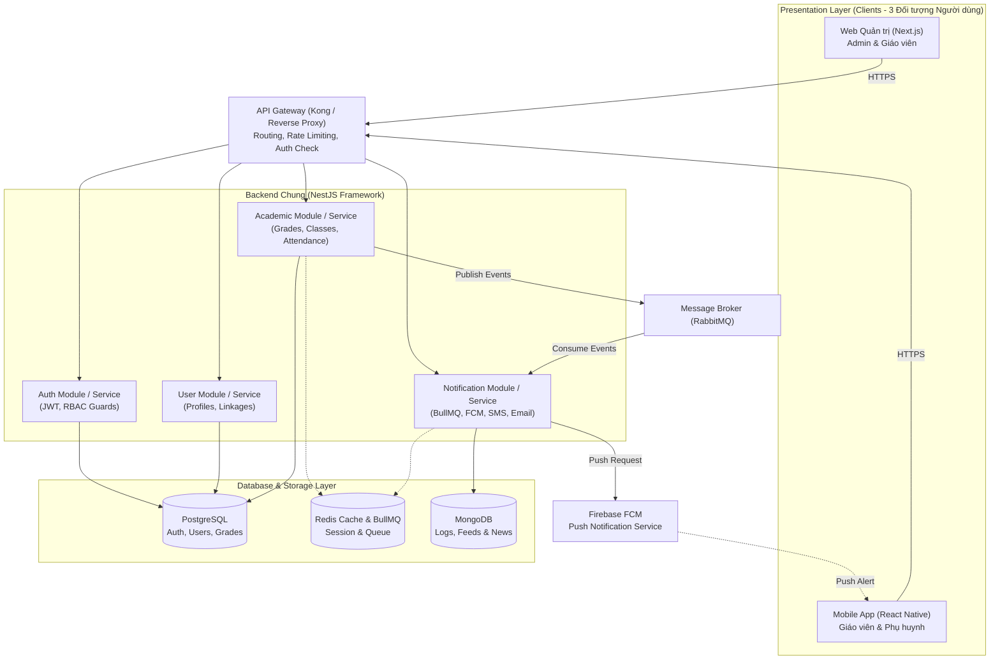

# EduConnect (GiaoVienHay) – Master System Architecture Document

> **Lưu ý:** Hệ thống tài liệu kiến trúc dự án đã được chuẩn hóa và tổ chức thành các thư mục chuyên biệt tương tự mô hình chuẩn của `E:\AITA` (bao gồm `docs/architecture/`, `docs/diagrams/puml/`, `docs/apis/`, `docs/testcases/`, `rules/`). Phiên bản kiến trúc này loại bỏ hoàn toàn module AI Prompt/LLM theo yêu cầu.

---

## 1. Mục lục Tài liệu Dự án (Documentation Index)

### 1.1. Tài liệu Kiến trúc & Yêu cầu (`docs/architecture/`)
- 📄 **[system-overview.md](file:///e:/GiaoVienHay/docs/architecture/system-overview.md)**: Tổng quan hệ thống, bối cảnh, 3 nhóm đối tượng người dùng, tiêu chuẩn chất lượng.
- 📄 **[tech-stack.md](file:///e:/GiaoVienHay/docs/architecture/tech-stack.md)**: Đặc tả ngăn xếp công nghệ (Next.js, React Native, NestJS, PostgreSQL, MongoDB, Redis, RabbitMQ, FCM).
- 📄 **[actors_and_use_cases.md](file:///e:/GiaoVienHay/docs/architecture/actors_and_use_cases.md)**: Danh mục 3 tác nhân chính (`Admin`, `Teacher`, `Parent`) và ma trận Use Cases.
- 📄 **[use_case_descriptions.md](file:///e:/GiaoVienHay/docs/architecture/use_case_descriptions.md)**: Đặc tả chi tiết từng bước (Main Flow, Exceptions) cho các Use Cases cốt lõi.
- 📄 **[project-requirements.md](file:///e:/GiaoVienHay/docs/architecture/project-requirements.md)**: Yêu cầu chức năng (FR) và phi chức năng (NFR).
- 📄 **[api-response-codes.md](file:///e:/GiaoVienHay/docs/architecture/api-response-codes.md)**: Quy chuẩn Envelope Schema, HTTP Status Codes và từ điển mã lỗi nghiệp vụ (`AUTH_*`, `ACAD_*`,...).

### 1.2. Sơ đồ Thiết kế PlantUML (`docs/diagrams/puml/`)
- 📊 **[use_case_diagram.puml](file:///e:/GiaoVienHay/docs/diagrams/puml/use_case_diagram.puml)**: Sơ đồ Use Case toàn hệ thống phân theo phân hệ.
- 📊 **[activity_diagram.puml](file:///e:/GiaoVienHay/docs/diagrams/puml/activity_diagram.puml)**: Sơ đồ hoạt động quy trình điểm danh và bắn thông báo vắng học (Swimlanes).
- 📊 **[sequence_diagram.puml](file:///e:/GiaoVienHay/docs/diagrams/puml/sequence_diagram.puml)**: Sơ đồ tuần tự từ lúc Đăng nhập, Nhập điểm đến lúc Phụ huynh nhận push notification.
- 📊 **[communication_diagram.puml](file:///e:/GiaoVienHay/docs/diagrams/puml/communication_diagram.puml)**: Sơ đồ giao tiếp tương tác giữa các đối tượng.

### 1.3. Đặc tả API Endpoints (`docs/apis/`)
- 🔌 **[api-auth-spec.md](file:///e:/GiaoVienHay/docs/apis/auth/api-auth-spec.md)**: Đặc tả API xác thực, JWT, refresh token, logout.
- 🔌 **[api-academic-spec.md](file:///e:/GiaoVienHay/docs/apis/academic/api-academic-spec.md)**: Đặc tả API điểm danh và phê duyệt điểm số.
- 🔌 **[api-notification-spec.md](file:///e:/GiaoVienHay/docs/apis/notifications/api-notification-spec.md)**: Đặc tả API đăng ký Device Token FCM và lịch sử thông báo.

### 1.4. Kịch bản Kiểm thử (`docs/testcases/`)
- 🧪 **[unit-test-template.md](file:///e:/GiaoVienHay/docs/testcases/1-unit/unit-test-template.md)**: Mẫu kịch bản kiểm thử đơn vị (Unit Test - Jest).
- 🧪 **[integration-test-template.md](file:///e:/GiaoVienHay/docs/testcases/2-integration/integration-test-template.md)**: Mẫu kịch bản kiểm thử tích hợp (Integration Test - Testcontainers).
- 🧪 **[system-test-template.md](file:///e:/GiaoVienHay/docs/testcases/3-system/system-test-template.md)**: Mẫu kịch bản kiểm thử toàn hệ thống E2E (System Test).
- 🧪 **[acceptance-test-template.md](file:///e:/GiaoVienHay/docs/testcases/4-acceptance/acceptance-test-template.md)**: Mẫu kịch bản kiểm thử chấp nhận người dùng (UAT).

### 1.5. Quy tắc Dự án (`rules/`)
- 📋 **[git-rules.md](file:///e:/GiaoVienHay/rules/git-rules.md)**: Quy tắc đặt tên nhánh, conventional commits và bảo vệ nhánh `main`.
- 📋 **[testcase-rules.md](file:///e:/GiaoVienHay/rules/testcase-rules.md)**: Quy tắc đặt mã định danh testcase (`UT*`, `IT*`, `ST*`, `AT*`).

---

## 2. Mô hình kiến trúc tổng thể (High-Level Architecture)

---

## 3. Tóm lược các quyết định kiến trúc cốt lõi

1. **3 Nhóm đối tượng duy nhất:**
   - **Admin (Ban giám hiệu/Quản trị viên):** Sử dụng Web Next.js.
   - **Teacher (Giáo viên):** Sử dụng Web Next.js (nhập điểm lớn, quản trị) và Mobile React Native (điểm danh, nhận xét nhanh).
   - **Parent (Phụ huynh):** Sử dụng Mobile App React Native (nhận thông báo đẩy FCM, tra cứu điểm và chuyên cần, đóng học phí).
2. **Không có tính năng Chat:**
   - Giao tiếp giữa trường/giáo viên và phụ huynh là giao tiếp một chiều thông qua **Thông báo đẩy (FCM)** và **Bảng tin trường học (Feed)**.
3. **Không sử dụng AI Prompt / LLM:**
   - Tập trung vào sự ổn định, chính xác và hiệu năng cao của các nghiệp vụ quản lý giáo dục cốt lõi (điểm danh, sổ điểm, liên lạc phụ huynh, học phí).
