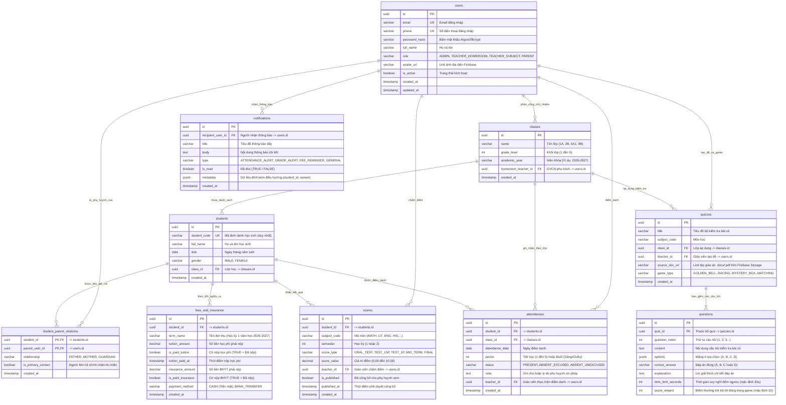

# Tài Liệu Thiết Kế Cơ Sở Dữ Liệu (Database Schema Specification)
# Hệ Thống GiaoVienHay – PostgreSQL 15 & Firebase Storage

Tài liệu này đặc tả chi tiết cấu trúc bảng, kiểu dữ liệu, các ràng buộc toàn vẹn (Constraints), chỉ mục (Indexes) và mối quan hệ giữa 10 bảng dữ liệu cốt lõi của hệ thống **GiaoVienHay**.

---

## 1. Nguyên Tắc & Quy Ước Thiết Kế CSDL

1. **Hệ quản trị CSDL chính:** **PostgreSQL 15+** (Đảm bảo giao dịch ACID, hỗ trợ JSONB cho câu hỏi/đáp án).
2. **Lưu trữ Tệp Tài liệu (File Storage):** Sử dụng **Firebase Cloud Storage**. Bảng CSDL chỉ lưu chuỗi URL an toàn (`source_doc_url`) trỏ tới tệp tài liệu giáo án `.docx`, `.pdf` đã upload.
3. **Quy ước đặt tên (Naming Convention):**
   - Tên bảng và tên cột: viết thường theo định dạng `snake_case`.
   - Khóa chính (Primary Key): Luôn sử dụng kiểu `UUID` (sinh tự động qua hàm `gen_random_uuid()`).
   - Khóa ngoại (Foreign Key): Tên bảng số ít kèm hậu tố `_id` (Ví dụ: `class_id`, `teacher_id`).
4. **Tính toàn vẹn & Ràng buộc:**
   - Thang điểm: Kiểm tra ràng buộc `CHECK (score_value >= 0.0 AND score_value <= 10.0)`.
   - Cờ trạng thái tài chính: Sử dụng kiểu `BOOLEAN` (`is_paid_tuition`, `is_paid_insurance`), mặc định là `FALSE`.

---

## 2. Sơ Đồ Quan Hệ Thực Thể Chi Tiết (Entity-Relationship Diagram)

---

## 3. Đặc Tả Chi Tiết 10 Bảng CSDL

### 3.1. Bảng `users` (Người Dùng Hệ Thống)
Quản lý tài khoản đăng nhập chung cho cả 4 nhóm vai trò.
- **`id`** (`UUID`, PK): Khóa chính ngẫu nhiên.
- **`email`** (`VARCHAR(150)`, UK, Nullable): Email xác thực và nhận thông báo.
- **`phone`** (`VARCHAR(20)`, UK, Nullable): Số điện thoại dùng để đăng nhập và gửi SMS.
- **`password_hash`** (`VARCHAR(255)`, Not Null): Chuỗi băm mật khẩu an toàn.
- **`full_name`** (`VARCHAR(100)`, Not Null): Họ và tên đầy đủ.
- **`role`** (`VARCHAR(30)`, Not Null): Vai trò người dùng (`ADMIN`, `TEACHER_HOMEROOM`, `TEACHER_SUBJECT`, `PARENT`).
- **`avatar_url`** (`VARCHAR(500)`, Nullable): Đường dẫn ảnh đại diện lưu trên Firebase Storage.
- **`is_active`** (`BOOLEAN`, Default: `TRUE`): Khóa hoặc mở tài khoản.

---

### 3.2. Bảng `classes` (Lớp Học Cấp 1 & Cấp 2)
Quản lý danh mục lớp học thuộc khối 1 đến khối 9.
- **`id`** (`UUID`, PK): Khóa chính.
- **`name`** (`VARCHAR(20)`, Not Null): Tên lớp học (Ví dụ: `1A`, `3C`, `6A1`, `9B`).
- **`grade_level`** (`INTEGER`, Not Null): Khối lớp từ `1` đến `9`.
- **`academic_year`** (`VARCHAR(20)`, Not Null): Niên khóa (Ví dụ: `2026-2027`).
- **`homeroom_teacher_id`** (`UUID`, FK -> `users.id`, Nullable): ID Giáo viên chủ nhiệm phụ trách lớp.

---

### 3.3. Bảng `students` (Học Sinh)
Lưu trữ hồ sơ học sinh thuộc các khối lớp.
- **`id`** (`UUID`, PK): Khóa chính.
- **`student_code`** (`VARCHAR(30)`, UK, Not Null): Mã số định danh học sinh duy nhất toàn trường.
- **`full_name`** (`VARCHAR(100)`, Not Null): Họ và tên học sinh.
- **`dob`** (`DATE`, Not Null): Ngày tháng năm sinh.
- **`gender`** (`VARCHAR(10)`, Not Null): Giới tính (`MALE` / `FEMALE`).
- **`class_id`** (`UUID`, FK -> `classes.id`, Not Null): Lớp học sinh đang theo học.

---

### 3.4. Bảng `student_parent_relations` (Quan Hệ Phụ Huynh - Học Sinh)
Bảng liên kết nhiều - nhiều giữa tài khoản Phụ huynh (`users`) và Học sinh (`students`).
- **`student_id`** (`UUID`, PK, FK -> `students.id`): ID học sinh.
- **`parent_user_id`** (`UUID`, PK, FK -> `users.id`): ID tài khoản phụ huynh.
- **`relationship`** (`VARCHAR(20)`, Not Null): Mối quan hệ (`FATHER`, `MOTHER`, `GUARDIAN`).
- **`is_primary_contact`** (`BOOLEAN`, Default: `TRUE`): Xác định người liên hệ chính khi phát thông báo khẩn cấp.

---

### 3.5. Bảng `scores` (Sổ Điểm Điện Tử)
Lưu trữ toàn bộ các đầu điểm kiểm tra thành phần theo môn học.
- **`id`** (`UUID`, PK): Khóa chính bản ghi điểm.
- **`student_id`** (`UUID`, FK -> `students.id`, Not Null): Học sinh nhận điểm.
- **`subject_code`** (`VARCHAR(20)`, Not Null): Mã môn học (`MATH`, `LIT`, `ENG`,...).
- **`semester`** (`INTEGER`, Not Null): Học kỳ `1` hoặc `2`.
- **`score_type`** (`VARCHAR(30)`, Not Null): Loại điểm (`ORAL_TEST` - kiểm tra bài cũ/miệng, `TEST_15P`, `TEST_1P`, `MID_TERM`, `FINAL`).
- **`score_value`** (`NUMERIC(4,2)`, Not Null): Điểm số từ `0.00` đến `10.00` (Ràng buộc: `CHECK (score_value >= 0 AND score_value <= 10)`).
- **`teacher_id`** (`UUID`, FK -> `users.id`, Not Null): Giáo viên nhập và phê duyệt điểm.
- **`is_published`** (`BOOLEAN`, Default: `FALSE`): Cờ xác nhận đã công bố cho phụ huynh xem.
- **`published_at`** (`TIMESTAMP`, Nullable): Thời điểm phê duyệt công bố điểm.

---

### 3.6. Bảng `attendances` (Điểm Danh Chuyên Cần)
Lưu vết trạng thái có mặt/vắng học của học sinh từng ngày.
- **`id`** (`UUID`, PK): Khóa chính.
- **`student_id`** (`UUID`, FK -> `students.id`, Not Null): Học sinh được điểm danh.
- **`class_id`** (`UUID`, FK -> `classes.id`, Not Null): Lớp học tại thời điểm điểm danh.
- **`attendance_date`** (`DATE`, Not Null): Ngày điểm danh.
- **`period`** (`INTEGER`, Not Null): Tiết học hoặc buổi (Sáng/Chiều).
- **`status`** (`VARCHAR(20)`, Not Null): Trạng thái (`PRESENT` - Có mặt, `ABSENT_EXCUSED` - Vắng có phép, `ABSENT_UNEXCUSED` - Vắng không phép).
- **`note`** (`TEXT`, Nullable): Ghi chú lý do vắng.
- **`teacher_id`** (`UUID`, FK -> `users.id`, Not Null): Giáo viên thực hiện điểm danh.

> **Chiến lược tối ưu tính năng Random học sinh:**
> Chỉ mục `idx_attendances_today (class_id, attendance_date, status)` giúp câu truy vấn:
> `SELECT student_id FROM attendances WHERE class_id = ? AND attendance_date = CURRENT_DATE AND status = 'PRESENT'`
> thực thi với tốc độ phản hồi cực nhanh dưới 5ms để nạp ngay vào Vòng quay may mắn.

---

### 3.7. Bảng `fees_and_insurance` (Quản Lý Thu Học Phí & BHYT)
Quản lý trạng thái hoàn thành nghĩa vụ tài chính của từng học sinh bằng 2 cờ boolean.
- **`id`** (`UUID`, PK): Khóa chính bản ghi thu phí.
- **`student_id`** (`UUID`, FK -> `students.id`, Not Null): Học sinh.
- **`term_name`** (`VARCHAR(100)`, Not Null): Tên đợt thu (Ví dụ: `Học phí & BHYT Học kỳ 1 năm 2026-2027`).
- **`tuition_amount`** (`NUMERIC(12,2)`, Default: `0`): Số tiền học phí phải nộp.
- **`is_paid_tuition`** (`BOOLEAN`, Default: `FALSE`, Not Null): **Cờ nộp học phí** (`TRUE` = Đã hoàn thành).
- **`tuition_paid_at`** (`TIMESTAMP`, Nullable): Thời điểm thanh toán học phí.
- **`insurance_amount`** (`NUMERIC(12,2)`, Default: `0`): Số tiền Bảo hiểm Y tế học sinh.
- **`is_paid_insurance`** (`BOOLEAN`, Default: `FALSE`, Not Null): **Cờ nộp BHYT** (`TRUE` = Đã hoàn thành).
- **`payment_method`** (`VARCHAR(30)`, Nullable): Hình thức nộp tiền (`CASH` - Nộp tiền mặt cho GVCN, `BANK_TRANSFER` - Chuyển khoản trực tiếp trường học).

---

### 3.8. Bảng `quizzes` (Bộ Đề Kiểm Tra & Mini-Game Lớp Học)
Quản lý các bộ câu hỏi kiểm tra bài cũ sinh ra từ tài liệu giáo án bài giảng.
- **`id`** (`UUID`, PK): Khóa chính bộ đề.
- **`title`** (`VARCHAR(200)`, Not Null): Tên bộ kiểm tra (Ví dụ: `Bài 12 - Phép cộng phân số`).
- **`subject_code`** (`VARCHAR(20)`, Not Null): Môn học.
- **`class_id`** (`UUID`, FK -> `classes.id`, Not Null): Lớp học được áp dụng.
- **`teacher_id`** (`UUID`, FK -> `users.id`, Not Null): Giáo viên tạo bộ quiz.
- **`source_doc_url`** (`VARCHAR(500)`, Nullable): **Đường dẫn tệp tài liệu giáo án gốc (`.docx`, `.pdf`) lưu trên Firebase Cloud Storage**.
- **`game_type`** (`VARCHAR(30)`, Default: `'GOLDEN_BELL'`): Kiểu mini-game hiển thị (`GOLDEN_BELL` - Rung chuông vàng, `RACING` - Đua xe, `MYSTERY_BOX` - Hộp quà, `MATCHING` - Chạm nối bảng thông minh).
- **`created_at`** (`TIMESTAMP`, Default: `NOW()`): Ngày tạo.

---

### 3.9. Bảng `questions` (Chi Tiết Câu Hỏi Kiểm Tra Bài Cũ)
Lưu danh sách câu hỏi thuộc bộ đề thi / trò chơi.
- **`id`** (`UUID`, PK): Khóa chính câu hỏi.
- **`quiz_id`** (`UUID`, FK -> `quizzes.id`, On Delete Cascade): Thuộc bộ đề quiz.
- **`question_index`** (`INTEGER`, Not Null): Số thứ tự câu hỏi trong game (1, 2, 3...).
- **`content`** (`TEXT`, Not Null): Nội dung câu hỏi kiểm tra.
- **`options`** (`JSONB`, Not Null): Mảng 4 đáp án lựa chọn định dạng JSON: `["Đáp án A", "Đáp án B", "Đáp án C", "Đáp án D"]`.
- **`correct_answer`** (`VARCHAR(10)`, Not Null): Ký tự đáp án đúng (`A`, `B`, `C` hoặc `D`).
- **`explanation`** (`TEXT`, Nullable): Lời giải thích chi tiết giúp học sinh hiểu bài ngay trên lớp.
- **`time_limit_seconds`** (`INTEGER`, Default: `30`): Thời gian đếm ngược suy nghĩ (giây).
- **`score_reward`** (`INTEGER`, Default: `10`): Điểm thưởng tích lũy cho đội/học sinh khi trả lời đúng trong game.

---

### 3.10. Bảng `notifications` (Lịch Sử Thông Báo Đẩy)
Lưu nhật ký các thông báo đẩy đã phát tới phụ huynh qua Firebase Cloud Messaging.
- **`id`** (`UUID`, PK): Khóa chính thông báo.
- **`recipient_user_id`** (`UUID`, FK -> `users.id`, Not Null): Tài khoản phụ huynh nhận thông báo.
- **`title`** (`VARCHAR(200)`, Not Null): Tiêu đề thông báo.
- **`body`** (`TEXT`, Not Null): Nội dung thông báo hiển thị trên banner điện thoại.
- **`type`** (`VARCHAR(50)`, Not Null): Loại thông báo (`ATTENDANCE_ALERT` - Vắng học, `GRADE_ALERT` - Điểm mới, `FEE_REMINDER` - Nhắc đóng BHYT/học phí, `GENERAL` - Thông báo chung).
- **`is_read`** (`BOOLEAN`, Default: `FALSE`): Trạng thái phụ huynh đã mở xem trên ứng dụng.
- **`metadata`** (`JSONB`, Nullable): Payload dữ liệu đính kèm (Ví dụ: `{"student_id": "uuid", "screen": "ChildAttendance"}`).
- **`created_at`** (`TIMESTAMP`, Default: `NOW()`): Thời gian gửi thông báo.

---

## 4. Chiến Lược Chỉ Mục Tối Ưu Truy Vấn (Indexing Strategy)

| Tên Chỉ Mục (Index Name) | Bảng | Các Cột Chỉ Mục | Mục Đích Tối Ưu |
| :--- | :--- | :--- | :--- |
| `idx_users_email` | `users` | `email` (B-Tree) | Tối ưu đăng nhập và kiểm tra trùng email |
| `idx_users_phone` | `users` | `phone` (B-Tree) | Tối ưu đăng nhập qua số điện thoại |
| `idx_attendances_today` | `attendances` | `class_id, attendance_date, status` | **Tối ưu tốc độ lấy danh sách học sinh CÓ MẶT cho Vòng quay Random (< 5ms)** |
| `idx_scores_student_subject` | `scores` | `student_id, subject_code, semester` | Tối ưu hiển thị sổ điểm môn học và tính điểm trung bình |
| `idx_fees_insurance_filter` | `fees_and_insurance` | `student_id, is_paid_insurance, is_paid_tuition` | **Tối ưu bộ lọc học sinh chưa nộp BHYT để phát tin nhắc nhở** |
| `idx_questions_quiz_id` | `questions` | `quiz_id, question_index` | Tối ưu tải nhanh bộ câu hỏi khi bắt đầu trò chơi lớp học |
| `idx_notifications_user` | `notifications` | `recipient_user_id, is_read, created_at` | Tối ưu tải trang thông báo trên Mobile App Phụ huynh |

