# Tài Liệu Thiết Kế Cơ Sở Dữ Liệu NoSQL (Firestore Schema Specification)
# Hệ Thống GiaoVienHay – 100% Nền Tảng Google Cloud Firestore

Tài liệu này đặc tả chi tiết cấu trúc Collections, Subcollections, Document Fields, kiểu dữ liệu Firestore, Composite Indexes và Security Rules của hệ thống **GiaoVienHay** trên nền tảng **Google Cloud Firestore**.

---

## 1. Nguyên Tắc & Quy Ước Thiết Kế Firestore NoSQL

1. **Hệ quản trị CSDL duy nhất:** **Google Cloud Firestore** (NoSQL Document Store phân tán toàn cầu, đồng bộ Realtime, tích hợp native với Firebase Ecosystem).
2. **Lưu trữ Tệp Giáo Án (File Storage):** Sử dụng **Firebase Cloud Storage**. Document trong Firestore chỉ lưu chuỗi URL an toàn (`source_doc_url`) trỏ tới tệp tài liệu giáo án `.docx`, `.pdf` đã upload.
3. **Quy ước đặt tên (Naming Convention):**
   - Tên Collections: viết thường số nhiều theo định dạng `snake_case` (ví dụ: `users`, `classes`, `students`, `scores`, `attendances`, `fees_and_insurance`, `quizzes`, `quiz_results`, `notifications`).
   - Tên Document ID: Sử dụng Firebase Auto-generated ID (20 ký tự) hoặc Auth UID cho collection `users`.
   - Tên trường (Fields): Viết thường theo định dạng `snake_case`.
4. **Kiểu dữ liệu hỗ trợ trong Firestore:**
   - `string`: Chuỗi ký tự UTF-8.
   - `number`: Số thực / số nguyên (ví dụ: điểm số 0.0 - 10.0).
   - `boolean`: Cờ logic (`TRUE` / `FALSE`).
   - `timestamp`: Đối tượng mốc thời gian Firestore `Timestamp` (chính xác đến nano-giây).
   - `array`: Mảng danh sách giá trị (ví dụ: mảng đáp án, mảng FCM tokens).
   - `map`: Đối tượng JSON lồng nhau (Key-Value map).
   - `reference`: DocumentReference liên kết giữa các tài liệu.

---

## 2. Sơ Đồ Cấu Trúc Collections & Subcollections

```mermaid
erDiagram
    users ||--o{ classes : manages_as_homeroom
    classes ||--|{ students : contains_students
    users ||--o{ students : links_parent
    students ||--o{ scores : has_scores
    classes ||--o{ attendances : records_attendance
    students ||--o{ fees_and_insurance : tracks_fees
    users ||--o{ quizzes : creates_quiz
    quizzes ||--|{ questions_subcollection : contains_questions
    quizzes ||--o{ quiz_results : records_in_class_results
    users ||--o{ notifications : receives_notifications

    users {
        string uid PK "Document ID = Firebase Auth UID"
        string email "Email người dùng"
        string phone "Số điện thoại đăng nhập"
        string full_name "Họ và tên"
        string role "ADMIN, TEACHER_HOMEROOM, TEACHER_SUBJECT, PARENT"
        string avatar_url "Link ảnh đại diện Firebase Storage"
        array fcm_tokens "Mảng FCM Device Tokens để nhận Push Notification"
        boolean is_active "Trạng thái kích hoạt tài khoản"
        timestamp created_at "Ngày tạo"
        timestamp updated_at "Ngày cập nhật"
    }

    classes {
        string id PK "Auto ID"
        string name "Tên lớp (1A, 2B, 6A1, 9B)"
        int grade_level "Khối lớp (1 đến 9)"
        string academic_year "Niên khóa (2026-2027)"
        string homeroom_teacher_id "UID Giáo viên chủ nhiệm tạo & quản lý lớp"
        array subject_teachers "Phân công GVBM theo môn [{teacher_id, subject_code}]"
        string invite_code UK "Mã mời 6-8 ký tự ngẫu nhiên duy nhất"
        string invite_link "Đường dẫn liên kết mời phụ huynh vào lớp"
        string created_by "UID Giáo viên tạo lớp"
        timestamp created_at
    }

    students {
        string id PK "Auto ID"
        string student_code UK "Mã định danh học sinh duy nhất"
        string full_name "Họ và tên học sinh"
        date dob "Ngày sinh"
        string gender "MALE hoặc FEMALE"
        string class_id "ID lớp học sinh đang học"
        array parent_uids "Mảng các UID phụ huynh liên kết"
        timestamp created_at
    }

    attendances {
        string id PK "Auto ID"
        string class_id "ID lớp học"
        string student_id "ID học sinh"
        string attendance_date "Chuỗi ngày YYYY-MM-DD"
        int period "Tiết học hoặc buổi sáng/chiều"
        string status "PRESENT (Có mặt), ABSENT_EXCUSED, ABSENT_UNEXCUSED"
        string note "Lý do vắng nếu có"
        string teacher_id "UID Giáo viên điểm danh"
        timestamp created_at
    }

    scores {
        string id PK "Auto ID"
        string student_id "ID học sinh nhận điểm"
        string class_id "ID lớp học"
        string subject_code "Mã môn học (MATH, LIT, ENG...)"
        int semester "Học kỳ 1 hoặc 2"
        string score_type "ORAL_TEST, TEST_15P, TEST_1P, MID_TERM, FINAL"
        number score_value "Thang điểm 0.0 - 10.0"
        string teacher_comment "Lời nhận xét của giáo viên kèm điểm số"
        string teacher_id "UID Giáo viên nhập điểm"
        boolean is_published "Cờ công bố cho phụ huynh xem"
        timestamp published_at "Thời điểm công bố"
        timestamp created_at
    }

    remarks {
        string id PK "Auto ID"
        string student_id "ID học sinh nhận nhận xét"
        string class_id "ID lớp học"
        string teacher_id "UID Giáo viên nhận xét"
        string subject_code "Môn học liên quan (hoặc null nếu nhận xét chung)"
        string content "Đoạn text ngắn nhận xét gửi phụ huynh"
        boolean is_published "Cờ công bố cho phụ huynh"
        timestamp created_at
    }

    fees_and_insurance {
        string id PK "Auto ID"
        string student_id "ID học sinh"
        string class_id "ID lớp chủ nhiệm"
        string term_name "Tên đợt thu (Học kỳ 1 năm học 2026-2027)"
        number tuition_amount "Số tiền học phí"
        boolean is_paid_tuition "Cờ nộp học phí (TRUE = Đã nộp)"
        timestamp tuition_paid_at "Thời điểm ghi nhận nộp học phí"
        number insurance_amount "Số tiền BHYT"
        boolean is_paid_insurance "Cờ nộp BHYT (TRUE = Đã nộp)"
        timestamp insurance_paid_at "Thời điểm ghi nhận nộp BHYT"
        string note "Ghi chú thu nộp của GVCN"
        timestamp created_at
    }

    quizzes {
        string id PK "Auto ID"
        string title "Tiêu đề bộ đề kiểm tra bài cũ"
        string subject_code "Môn học"
        string class_id "Lớp áp dụng"
        string teacher_id "UID Giáo viên tạo đề"
        string source_doc_url "Link tệp giáo án .docx/.pdf trên Firebase Storage"
        string game_type "GOLDEN_BELL, RACING, MYSTERY_BOX"
        timestamp created_at
    }

    questions_subcollection {
        string id PK "Subcollection: /quizzes/{quizId}/questions/{id}"
        int question_index "Thứ tự câu hỏi (1, 2, 3...)"
        string content "Nội dung câu hỏi kiểm tra bài cũ"
        array options "Mảng 4 phương án [A, B, C, D]"
        string correct_answer "Ký tự đáp án đúng (A, B, C hoặc D)"
        string explanation "Lời giải thích chi tiết"
        int time_limit_seconds "Thời gian suy nghĩ (mặc định 30s)"
    }

    quiz_results {
        string id PK "Auto ID"
        string quiz_id "ID bộ đề / game"
        string class_id "ID lớp học"
        string student_id "ID học sinh nhận điểm"
        string teacher_id "UID Giáo viên trực tiếp nhập điểm"
        number score "Điểm số GV chấm/nhập (thang 10)"
        string notes "Nhận xét của giáo viên"
        boolean is_synced_to_grades "Đã duyệt chuyển vào sổ điểm /scores"
        timestamp created_at "Thời điểm giáo viên nhập điểm"
    }

    notifications {
        string id PK "Auto ID"
        string recipient_user_id "UID phụ huynh nhận thông báo"
        string title "Tiêu đề thông báo đẩy"
        string body "Nội dung chi tiết thông báo"
        string type "ATTENDANCE_ALERT, GRADE_ALERT, FEE_REMINDER, GENERAL"
        boolean is_read "Trạng thái đã đọc (TRUE/FALSE)"
        map metadata "Payload điều hướng (student_id, screen)"
        timestamp created_at
    }
```



---

## 3. Đặc Tả Chi Tiết Từng Collection Firestore

### 3.1. Collection `/users`
Quản lý tài khoản đăng nhập chung cho cả 4 nhóm vai trò. Document ID chính là **Firebase Auth UID**.
- **`uid`** (`string`, Document ID): UID do Firebase Auth tạo ra.
- **`email`** (`string`, Nullable): Email xác thực và nhận thông báo.
- **`phone`** (`string`, Nullable): Số điện thoại dùng để đăng nhập OTP.
- **`full_name`** (`string`): Họ và tên đầy đủ.
- **`role`** (`string`): Vai trò (`ADMIN`, `TEACHER_HOMEROOM`, `TEACHER_SUBJECT`, `PARENT`).
- **`avatar_url`** (`string`, Nullable): Đường dẫn ảnh đại diện lưu trên Firebase Cloud Storage.
- **`fcm_tokens`** (`array of string`): Danh sách Device Tokens để gửi multicast Push Notification qua FCM.
- **`is_active`** (`boolean`, Default: `true`): Khóa hoặc mở tài khoản.
- **`created_at`** (`timestamp`): Thời điểm tạo tài khoản.
- **`updated_at`** (`timestamp`): Thời điểm cập nhật cuối.

---

### 3.2. Collection `/classes`
Quản lý danh mục lớp học thuộc khối 1 đến khối 9 do Giáo viên tạo.
- **`id`** (`string`, Document ID): Mã tự sinh Firestore.
- **`name`** (`string`): Tên lớp học (Ví dụ: `1A`, `3C`, `6A1`, `9B`).
- **`grade_level`** (`number`): Khối lớp từ `1` đến `9`.
- **`academic_year`** (`string`): Niên khóa (Ví dụ: `2026-2027`).
- **`homeroom_teacher_id`** (`string`): UID Giáo viên chủ nhiệm (GVCN) - người tạo lớp và quản lý lớp tổng.
- **`subject_teachers`** (`array of map`): Danh sách phân công Giáo viên bộ môn (GVBM) theo từng môn học trong lớp:
  - `[ { "teacher_id": "uid_gvbm_math", "subject_code": "MATH" }, { "teacher_id": "uid_gvbm_lit", "subject_code": "LIT" } ]`.
  - Giúp GVBM chỉ cần đăng nhập là truy cập được lớp tổng và chỉ được phép thay đổi điểm của bộ môn mình phụ trách.
- **`created_by`** (`string`): UID Giáo viên chủ nhiệm tạo lớp.
- **`invite_code`** (`string`, Unique): Mã mời ngắn (6-8 ký tự) để phụ huynh nhập khi vào lớp.
- **`invite_link`** (`string`): Đường dẫn liên kết mời phụ huynh (Ví dụ: `https://giaovienhay.vn/join?code=ABC123XYZ`).
- **`created_at`** (`timestamp`): Thời điểm tạo lớp.

---

### 3.3. Collection `/students`
Lưu trữ hồ sơ học sinh thuộc các khối lớp.
- **`id`** (`string`, Document ID): Mã tự sinh Firestore.
- **`student_code`** (`string`): Mã số định danh học sinh duy nhất toàn trường.
- **`full_name`** (`string`): Họ và tên học sinh.
- **`dob`** (`string` / `timestamp`): Ngày tháng năm sinh.
- **`gender`** (`string`): Giới tính (`MALE` / `FEMALE`).
- **`class_id`** (`string`): ID lớp học sinh đang theo học trỏ đến `/classes/{id}`.
- **`parent_uids`** (`array of string`): Danh sách UID phụ huynh liên kết (phục vụ truy vấn nhanh danh sách con của phụ huynh: `where('parent_uids', 'array-contains', parentUid)`).
- **`created_at`** (`timestamp`): Thời điểm tạo hồ sơ.

---

### 3.4. Collection `/attendances`
Lưu vết trạng thái có mặt/vắng học của học sinh từng ngày.
- **`id`** (`string`, Document ID): Mã tự sinh Firestore.
- **`student_id`** (`string`): ID học sinh được điểm danh.
- **`class_id`** (`string`): Lớp học tại thời điểm điểm danh.
- **`attendance_date`** (`string`): Chuỗi ngày điểm danh `YYYY-MM-DD`.
- **`period`** (`number`): Tiết học hoặc buổi (Sáng/Chiều).
- **`status`** (`string`): Trạng thái (`PRESENT` - Có mặt, `ABSENT_EXCUSED` - Vắng có phép, `ABSENT_UNEXCUSED` - Vắng không phép).
- **`note`** (`string`, Nullable): Ghi chú lý do vắng.
- **`teacher_id`** (`string`): UID Giáo viên thực hiện điểm danh.
- **`created_at`** (`timestamp`): Thời gian ghi nhận điểm danh.

> **Cơ chế Vòng quay kiểm tra bài cũ thông minh:**
> - Vòng quay chọn ngẫu nhiên học sinh trong lớp.
> - Nếu quay trúng bạn nào nghỉ học hoặc vắng mặt/không thể lên bảng, Giáo viên chỉ cần bấm nút **"Bỏ qua (Skip)"**, hệ thống tự động quay ngay vòng mới để chọn bạn khác.
>   .where('attendance_date', '==', todayStr)
>   .where('status', '==', 'PRESENT')
>   .get();
> ```
> Kết hợp **Firestore Composite Index** `(class_id ASC, attendance_date ASC, status ASC)` giúp trả về danh sách học sinh CÓ MẶT cực nhanh dưới 5ms để nạp ngay vào Vòng quay may mắn trên Web Next.js.

---

### 3.5. Collection `/scores`
Lưu trữ sổ điểm điện tử đa môn học toàn diện theo học sinh với nhiều đầu điểm thành phần.
- **`id`** (`string`, Document ID): Mã tự sinh.
- **`student_id`** (`string`): ID học sinh nhận điểm.
- **`class_id`** (`string`): ID lớp học.
- **`subject_code`** (`string`): Mã môn học đa dạng theo chương trình GDPT:
  - `MATH`: Toán học
  - `LIT`: Tiếng Việt (Cấp 1) / Ngữ văn (Cấp 2)
  - `ENG`: Tiếng Anh / Ngoại ngữ
  - `SCI`: Tự nhiên & Xã hội / Khoa học tự nhiên
  - `HIS_GEO`: Lịch sử & Địa lý
  - `IT`: Tin học
  - `ETHICS`: Đạo đức (Cấp 1) / Giáo dục công dân (Cấp 2)
  - `ART_MUSIC`: Nghệ thuật (Âm nhạc, Mỹ thuật)
  - `PE`: Giáo dục thể chất
- **`semester`** (`number`): Học kỳ `1` hoặc `2`.
- **`score_type`** (`string`): Các đầu điểm thành phần phong phú:
  - `ORAL_TEST`: Điểm kiểm tra bài cũ / kiểm tra miệng đầu giờ (hệ số 1)
  - `QUIZ`: Điểm mini-game / trả lời câu hỏi tương tác trên lớp (hệ số 1)
  - `TEST_15P`: Điểm kiểm tra thường xuyên 15 phút (hệ số 1)
  - `TEST_1P`: Điểm kiểm tra 1 tiết / định kỳ
  - `MID_TERM`: Điểm thi Giữa học kỳ
  - `FINAL`: Điểm thi Cuối học kỳ
- **`score_value`** (`number`): Điểm số từ `0.0` đến `10.0` (bước nhảy 0.1) do Giáo viên chấm/nhập.
- **`teacher_comment`** (`string`, Nullable): Lời nhận xét, góp ý ngắn của giáo viên kèm theo đầu điểm (Ví dụ: *"Bài làm cẩn thận"*).
- **`teacher_id`** (`string`): UID Giáo viên trực tiếp nhập điểm (GVBM hoặc GVCN).
- **`is_published`** (`boolean`, Default: `false`): Cờ xác nhận đã công bố cho phụ huynh xem trên app.
- **`published_at`** (`timestamp`, Nullable): Thời điểm phê duyệt công bố điểm.
- **`created_at`** (`timestamp`): Ngày nhập điểm.

> **Ghi chú về tính điểm:** Hệ thống lưu trữ trung thực các cột điểm thành phần do Giáo viên nhập và không tự động tính Điểm trung bình môn (GPA môn).

---

### 3.6. Collection `/remarks`
Lưu trữ sổ nhận xét, đánh giá học sinh của Giáo viên gửi tới Phụ huynh (dưới dạng đoạn text ngắn).
- **`id`** (`string`, Document ID): Mã tự sinh Firestore.
- **`student_id`** (`string`): ID học sinh được nhận xét.
- **`class_id`** (`string`): ID lớp học.
- **`teacher_id`** (`string`): UID Giáo viên đưa ra nhận xét.
- **`teacher_name`** (`string`): Họ và tên Giáo viên nhận xét.
- **`subject_code`** (`string`, Nullable): Môn học liên quan (hoặc `NULL` nếu là nhận xét chung của GVCN).
- **`content`** (`string`): **Nội dung lời nhận xét ngắn gọn (đoạn text ngắn)** gửi tới phụ huynh (Ví dụ: *"Hôm nay em phát biểu rất hăng hái"*, *"Em cần chú ý nghe giảng hơn"* - Không sử dụng thẻ nhãn tags).
- **`is_published`** (`boolean`, Default: `true`): Cờ cho phép phụ huynh xem trên ứng dụng.
- **`parent_acknowledged`** (`boolean`, Default: `false`): Cờ xác nhận Phụ huynh đã đọc phản hồi.
- **`created_at`** (`timestamp`): Thời điểm tạo lời nhận xét.

---

### 3.7. Collection `/fees_and_insurance`
Sổ theo dõi trạng thái hoàn thành nghĩa vụ tài chính của từng học sinh bằng 2 cờ boolean. **Hệ thống hoàn toàn không có tính năng thanh toán trực tuyến**. Phụ huynh và học sinh hoàn thành nghĩa vụ trực tiếp tại trường/lớp; GVCN hoặc Quản trị viên chỉ tích chọn cờ boolean để theo dõi.
- **`id`** (`string`, Document ID): Mã tự sinh.
- **`student_id`** (`string`): ID học sinh.
- **`class_id`** (`string`): ID lớp chủ nhiệm.
- **`term_name`** (`string`): Tên đợt thu (Ví dụ: `Học phí & BHYT Học kỳ 1 năm 2026-2027`).
- **`tuition_amount`** (`number`, Default: `0`): Số tiền học phí phải nộp.
- **`is_paid_tuition`** (`boolean`, Default: `false`): **Cờ nộp học phí** (`true` = Đã nộp).
- **`tuition_paid_at`** (`timestamp`, Nullable): Thời điểm ghi nhận hoàn thành nộp học phí.
- **`insurance_amount`** (`number`, Default: `0`): Số tiền Bảo hiểm Y tế học sinh.
- **`is_paid_insurance`** (`boolean`, Default: `false`): **Cờ nộp BHYT** (`true` = Đã nộp).
- **`insurance_paid_at`** (`timestamp`, Nullable): Thời điểm ghi nhận hoàn thành nộp BHYT.
- **`note`** (`string`, Nullable): Ghi chú thu nộp của GVCN/Nhà trường.
- **`created_at`** (`timestamp`): Ngày tạo bản ghi.

---

### 3.8. Collection `/quizzes` & Subcollection `/questions`
Quản lý các bộ câu hỏi kiểm tra bài cũ sinh ra từ tài liệu giáo án bài giảng.
- **`id`** (`string`, Document ID): Mã tự sinh bộ đề.
- **`title`** (`string`): Tên bộ kiểm tra (Ví dụ: `Bài 12 - Phép cộng phân số`).
- **`subject_code`** (`string`): Môn học.
- **`class_id`** (`string`): Lớp học được áp dụng.
- **`teacher_id`** (`string`): UID Giáo viên tạo bộ quiz.
- **`source_doc_url`** (`string`, Nullable): **Đường dẫn tệp tài liệu giáo án gốc (`.docx`, `.pdf`) lưu trên Firebase Cloud Storage**.
- **`game_type`** (`string`, Default: `'GOLDEN_BELL'`): Kiểu mini-game hiển thị (`GOLDEN_BELL` - Rung chuông vàng, `RACING` - Đua xe, `MYSTERY_BOX` - Hộp quà bí mật).
- **`created_at`** (`timestamp`): Ngày tạo.

**Subcollection `/quizzes/{quizId}/questions/{questionId}`**:
- **`question_index`** (`number`): Số thứ tự câu hỏi trong game (1, 2, 3...).
- **`content`** (`string`): Nội dung câu hỏi kiểm tra.
- **`options`** (`array of string`): Mảng 4 đáp án lựa chọn: `["Đáp án A", "Đáp án B", "Đáp án C", "Đáp án D"]`.
- **`correct_answer`** (`string`): Ký tự đáp án đúng (`A`, `B`, `C` hoặc `D`).
- **`explanation`** (`string`, Nullable): Lời giải thích chi tiết giúp học sinh hiểu bài ngay trên lớp.
- **`time_limit_seconds`** (`number`, Default: `30`): Thời gian đếm ngược suy nghĩ (giây).

---

### 3.9. Collection `/quiz_results`
Lưu trữ điểm số kiểm tra bài cũ hoặc kết quả tham gia mini-game tại lớp **do Giáo viên trực tiếp nhập** cho từng học sinh (Ứng dụng hoàn toàn không cho học sinh làm bài thi hay tự động chấm bài trực tuyến). Bảng xếp hạng (Leaderboard) vinh danh tại lớp được lấy từ Sổ điểm môn học (`/scores`), hệ thống không xếp hạng điểm mini-game.
- **`id`** (`string`, Document ID): Mã tự sinh.
- **`quiz_id`** (`string`): Thuộc bài kiểm tra bài cũ / mini-game nào.
- **`class_id`** (`string`): Lớp học sinh tham gia.
- **`student_id`** (`string`): ID học sinh nhận điểm.
- **`teacher_id`** (`string`): UID Giáo viên trực tiếp nhập điểm.
- **`score`** (`number`): Điểm số do Giáo viên chấm/nhập (thang 10).
- **`notes`** (`string`, Nullable): Nhận xét của giáo viên về câu trả lời của học sinh.
- **`is_synced_to_grades`** (`boolean`, Default: `false`): Trạng thái giáo viên đã phê duyệt chuyển điểm vào sổ điểm chính thức `/scores`.
- **`created_at`** (`timestamp`): Thời điểm giáo viên nhập điểm.

---

### 3.10. Collection `/notifications`
Lưu nhật ký các thông báo đẩy đã phát tới phụ huynh qua Firebase Cloud Messaging.
- **`id`** (`string`, Document ID): Mã tự sinh.
- **`recipient_user_id`** (`string`): UID phụ huynh nhận thông báo trỏ đến `/users/{uid}`.
- **`title`** (`string`): Tiêu đề thông báo.
- **`body`** (`string`): Nội dung thông báo hiển thị trên banner điện thoại.
- **`type`** (`string`): Loại thông báo (`ATTENDANCE_ALERT` - Vắng học, `GRADE_ALERT` - Điểm mới, `FEE_REMINDER` - Nhắc đóng BHYT/học phí, `GENERAL` - Thông báo chung).
- **`is_read`** (`boolean`, Default: `false`): Trạng thái phụ huynh đã mở xem trên ứng dụng.
- **`metadata`** (`map`, Nullable): Payload dữ liệu đính kèm (Ví dụ: `{"student_id": "id", "screen": "ChildAttendance"}`).
- **`created_at`** (`timestamp`): Thời gian gửi thông báo.

---

## 4. Chiến Lược Chỉ Mục Firestore (Composite Indexes)

Trong Google Cloud Firestore, các truy vấn đơn trường được lập chỉ mục tự động. Dưới đây là danh sách **Composite Indexes** bắt buộc cấu hình trong file `firestore.indexes.json` để tối ưu các truy vấn lọc phức hợp:

| Collection ID | Các Trường Chỉ Mục Phức Hợp (Fields & Orders) | Mục Đích Tối Ưu Hóa |
| :--- | :--- | :--- |
| `attendances` | `class_id` (ASC), `attendance_date` (ASC), `status` (ASC) | **Lọc siêu tốc (< 5ms) danh sách học sinh CÓ MẶT cho Vòng quay Random** |
| `scores` | `student_id` (ASC), `subject_code` (ASC), `semester` (ASC) | Tối ưu hiển thị sổ điểm môn học và tính điểm trung bình cho học bạ |
| `scores` | `class_id` (ASC), `subject_code` (ASC), `is_published` (ASC) | Tối ưu tải bảng điểm lớp học theo môn học cho giáo viên |
| `scores` | `class_id` (ASC), `subject_code` (ASC), `score_value` (DESC) | **Truy xuất Bảng xếp hạng (Leaderboard) Điểm Môn Học vinh danh tại lớp** |
| `fees_and_insurance`| `class_id` (ASC), `is_paid_insurance` (ASC), `is_paid_tuition` (ASC) | **Tối ưu bộ lọc học sinh chưa nộp BHYT để phát tin nhắc nhở tức thì** |
| `notifications` | `recipient_user_id` (ASC), `created_at` (DESC) | Tải danh sách thông báo mới nhất trên Mobile App Phụ huynh |
| `students` | `parent_uids` (Arrays), `full_name` (ASC) | Tối ưu hiển thị danh sách các con thuộc cùng một tài khoản phụ huynh |

---

## 5. Quy Tắc Bảo Mật Dữ Liệu (Firestore Security Rules)

Quy tắc bảo mật được định nghĩa chặt chẽ theo vai trò (RBAC) dựa trên Custom Claims của Firebase Auth (`request.auth.token.role`):

```javascript
rules_version = '2';
service cloud.firestore {
  match /databases/{database}/documents {
    
    // Hàm trợ giúp kiểm tra xác thực và vai trò
    function isAuthenticated() {
      return request.auth != null;
    }
    
    function isAdmin() {
      return isAuthenticated() && request.auth.token.role == 'ADMIN';
    }
    
    function isTeacher() {
      return isAuthenticated() && (request.auth.token.role == 'TEACHER_HOMEROOM' || request.auth.token.role == 'TEACHER_SUBJECT');
    }
    
    function isParent() {
      return isAuthenticated() && request.auth.token.role == 'PARENT';
    }

    // 1. Collection users: Tự xem/sửa hồ sơ chính mình, Admin toàn quyền
    match /users/{userId} {
      allow read: if isAuthenticated();
      allow write: if isAdmin() || (isAuthenticated() && request.auth.uid == userId);
    }

    // 2. Collection classes & students: Admin toàn quyền, GV đọc/ghi điểm, Phụ huynh chỉ đọc hồ sơ con
    match /classes/{classId} {
      allow read: if isAuthenticated();
      allow write: if isAdmin();
    }

    match /students/{studentId} {
      allow read: if isAuthenticated();
      allow write: if isAdmin();
    }

    // 3. Collection attendances & scores: Giáo viên & Admin có quyền ghi; Phụ huynh chỉ đọc
    match /attendances/{attendanceId} {
      allow read: if isAuthenticated();
      allow write: if isTeacher() || isAdmin();
    }

    match /scores/{scoreId} {
      allow read: if isTeacher() || isAdmin() || (isParent() && resource.data.is_published == true);
      allow write: if isTeacher() || isAdmin();
    }

    // 4. Collection fees_and_insurance: Chỉ Admin & GVCN được ghi nhận cờ nộp; Phụ huynh chỉ xem
    match /fees_and_insurance/{recordId} {
      allow read: if isAuthenticated();
      allow write: if isTeacher() || isAdmin();
    }

    // 5. Quizzes & Quiz Results: Giáo viên & Admin toàn quyền
    match /quizzes/{quizId} {
      allow read, write: if isTeacher() || isAdmin();
      
      match /questions/{questionId} {
        allow read, write: if isTeacher() || isAdmin();
      }
    }

    match /quiz_results/{resultId} {
      allow read, write: if isTeacher() || isAdmin();
    }

    // 6. Notifications: Phụ huynh đọc thông báo của chính mình
    match /notifications/{notificationId} {
      allow read: if isAuthenticated() && request.auth.uid == resource.data.recipient_user_id;
      allow write: if isTeacher() || isAdmin();
    }
  }
}
```
