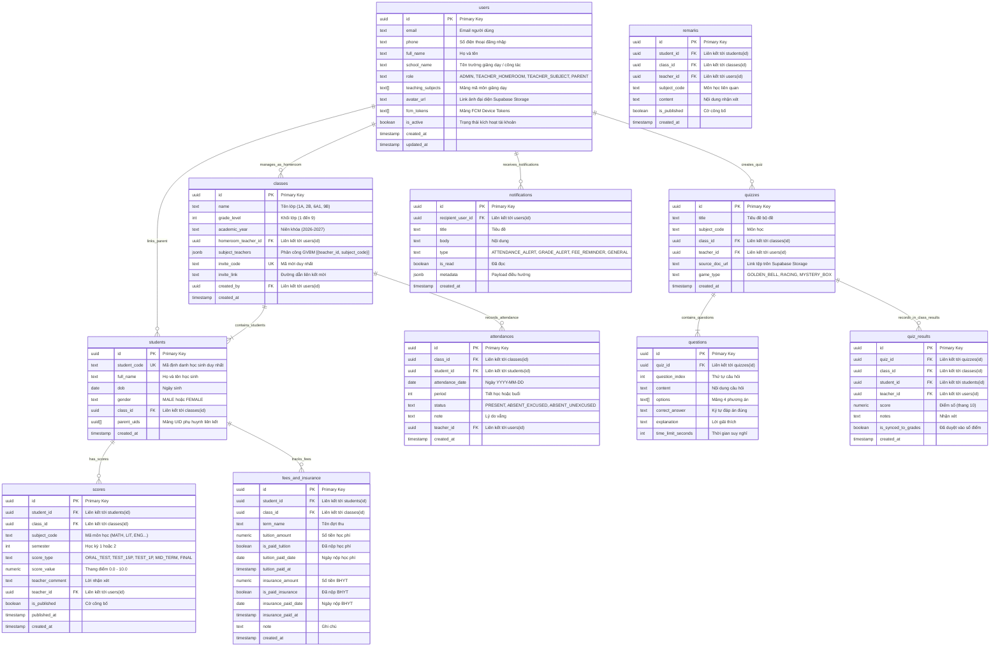

# Tài Liệu Thiết Kế Cơ Sở Dữ Liệu SQL (Supabase Schema Specification)

# Hệ Thống GiaoVienHay – Nền Tảng Supabase (PostgreSQL)

Tài liệu này đặc tả chi tiết cấu trúc các Bảng (Tables), Quan hệ (Relationships), Kiểu dữ liệu PostgreSQL và Quy tắc Bảo mật Hàng (RLS - Row Level Security) của hệ thống **GiaoVienHay** trên nền tảng **Supabase**.

---

## 1. Nguyên Tắc & Quy Ước Thiết Kế PostgreSQL

1. **Hệ quản trị CSDL duy nhất:** **Supabase PostgreSQL** (Relational Database, hỗ trợ ACID, đồng bộ Realtime thông qua Supabase Realtime).
2. **Lưu trữ Tệp Giáo Án (File Storage):** Sử dụng **Supabase Storage**. Các bảng trong DB chỉ lưu chuỗi URL hoặc đường dẫn trỏ tới tệp tài liệu giáo án `.docx`, `.pdf` đã upload.
3. **Quy ước đặt tên (Naming Convention):**
   - Tên Bảng (Tables): Viết thường số nhiều theo định dạng `snake_case` (ví dụ: `users`, `classes`, `students`, `scores`, `attendances`, `fees_and_insurance`, `quizzes`, `quiz_results`, `notifications`).
   - Khóa chính (Primary Key): Sử dụng `id` với kiểu dữ liệu `uuid` (mặc định của Supabase) hoặc `bigint` tự tăng.
   - Tên trường (Columns): Viết thường theo định dạng `snake_case`.
4. **Kiểu dữ liệu chính sử dụng:**
   - `uuid`: Định danh duy nhất (Primary Key / Foreign Key).
   - `text` / `varchar`: Chuỗi ký tự.
   - `numeric` / `int`: Số thực (điểm số) / Số nguyên.
   - `boolean`: Cờ logic (`TRUE` / `FALSE`).
   - `timestamp with time zone`: Mốc thời gian (thay thế cho Firestore Timestamp).
   - `jsonb`: Dữ liệu JSON linh hoạt (cho metadata hoặc mảng tùy chọn).

---

## 2. Sơ Đồ Quan Hệ Dữ Liệu (ER Diagram)

---

## 3. Đặc Tả Chi Tiết Từng Bảng (Table Specifications)

### 3.1. Table `users`
Quản lý tài khoản đăng nhập chung cho cả 4 nhóm vai trò.
- **`id`** (`uuid`, PK): Primary Key, đồng bộ với Supabase Auth UID.
- **`email`** (`text`, Nullable): Email xác thực.
- **`phone`** (`text`, Nullable): Số điện thoại đăng nhập.
- **`full_name`** (`text`): Họ và tên đầy đủ.
- **`school_name`** (`text`, Nullable): Tên trường công tác.
- **`role`** (`text`): Vai trò (`ADMIN`, `TEACHER_HOMEROOM`, `TEACHER_SUBJECT`, `PARENT`).
- **`teaching_subjects`** (`text[]`, Nullable): Mảng mã môn giảng dạy.
- **`avatar_url`** (`text`, Nullable): Link ảnh đại diện Supabase Storage.
- **`fcm_tokens`** (`text[]`): Danh sách Device Tokens gửi qua FCM.
- **`is_active`** (`boolean`, Default: `true`): Trạng thái tài khoản.
- **`created_at`** (`timestamp`): Ngày tạo.
- **`updated_at`** (`timestamp`): Ngày cập nhật cuối.

---

### 3.2. Table `classes`
Quản lý danh mục lớp học từ khối 1 đến 9.
- **`id`** (`uuid`, PK): Primary Key.
- **`name`** (`text`): Tên lớp (Ví dụ: `1A`, `6A1`).
- **`grade_level`** (`int`): Khối lớp (`1` đến `9`).
- **`academic_year`** (`text`): Niên khóa (Ví dụ: `2026-2027`).
- **`homeroom_teacher_id`** (`uuid`, FK $\rightarrow$ `users.id`): Giáo viên chủ nhiệm.
- **`subject_teachers`** (`jsonb`): Phân công GVBM `[{teacher_id, subject_code}]`.
- **`created_by`** (`uuid`, FK $\rightarrow$ `users.id`): Người tạo lớp.
- **`invite_code`** (`text`, Unique): Mã mời ngắn.
- **`invite_link`** (`text`): Đường dẫn liên kết mời.
- **`created_at`** (`timestamp`): Thời điểm tạo lớp.

---

### 3.3. Table `students`
Hồ sơ học sinh.
- **`id`** (`uuid`, PK): Primary Key.
- **`student_code`** (`text`, Unique): Mã định danh duy nhất.
- **`full_name`** (`text`): Họ và tên học sinh.
- **`dob`** (`date`): Ngày tháng năm sinh.
- **`gender`** (`text`): Giới tính (`MALE` / `FEMALE`).
- **`class_id`** (`uuid`, FK $\rightarrow$ `classes.id`): Lớp học hiện tại.
- **`parent_uids`** (`uuid[]`): Mảng các UID phụ huynh liên kết.
- **`created_at`** (`timestamp`): Thời điểm tạo.

---

### 3.4. Table `attendances`
Lưu vết điểm danh chuyên cần.
- **`id`** (`uuid`, PK): Primary Key.
- **`student_id`** (`uuid`, FK $\rightarrow$ `students.id`): Học sinh được điểm danh.
- **`class_id`** (`uuid`, FK $\rightarrow$ `classes.id`): Lớp học.
- **`attendance_date`** (`date`): Ngày điểm danh.
- **`period`** (`int`): Tiết học hoặc buổi.
- **`status`** (`text`): Trạng thái (`PRESENT`, `ABSENT_EXCUSED`, `ABSENT_UNEXCUSED`).
- **`note`** (`text`, Nullable): Lý do vắng.
- **`teacher_id`** (`uuid`, FK $\rightarrow$ `users.id`): Giáo viên điểm danh.
- **`created_at`** (`timestamp`): Thời gian ghi nhận.

> **Tối ưu cho Vòng quay Random:**
> Sử dụng Index trên `(class_id, attendance_date, status)` để truy vấn siêu tốc danh sách học sinh `PRESENT` nạp vào Vòng quay may mắn.

---

### 3.5. Table `scores`
Sổ điểm điện tử đa môn học.
- **`id`** (`uuid`, PK): Primary Key.
- **`student_id`** (`uuid`, FK $\rightarrow$ `students.id`): Học sinh nhận điểm.
- **`class_id`** (`uuid`, FK $\rightarrow$ `classes.id`): Lớp học.
- **`subject_code`** (`text`): Mã môn học (`MATH`, `LIT`, `ENG`...).
- **`semester`** (`int`): Học kỳ `1` hoặc `2`.
- **`score_type`** (`text`): Đầu điểm (`ORAL_TEST`, `QUIZ`, `TEST_15P`, `TEST_1P`, `MID_TERM`, `FINAL`).
- **`score_value`** (`numeric`): Điểm số từ `0.0` đến `10.0`.
- **`teacher_comment`** (`text`, Nullable): Nhận xét kèm điểm.
- **`teacher_id`** (`uuid`, FK $\rightarrow$ `users.id`): Giáo viên nhập điểm.
- **`is_published`** (`boolean`, Default: `false`): Cờ công bố cho phụ huynh.
- **`published_at`** (`timestamp`, Nullable): Thời điểm công bố.
- **`created_at`** (`timestamp`): Ngày nhập điểm.

---

### 3.6. Table `remarks`
Sổ nhận xét gửi phụ huynh.
- **`id`** (`uuid`, PK): Primary Key.
- **`student_id`** (`uuid`, FK $\rightarrow$ `students.id`): Học sinh được nhận xét.
- **`class_id`** (`uuid`, FK $\rightarrow$ `classes.id`): Lớp học.
- **`teacher_id`** (`uuid`, FK $\rightarrow$ `users.id`): Giáo viên nhận xét.
- **`subject_code`** (`text`, Nullable): Môn học liên quan.
- **`content`** (`text`): Nội dung nhận xét ngắn gọn.
- **`is_published`** (`boolean`, Default: `true`): Cờ công bố.
- **`created_at`** (`timestamp`): Thời điểm tạo.

---

### 3.7. Table `fees_and_insurance`
Theo dõi nộp Học phí & BHYT (Không thanh toán online).
- **`id`** (`uuid`, PK): Primary Key.
- **`student_id`** (`uuid`, FK $\rightarrow$ `students.id`): Học sinh.
- **`class_id`** (`uuid`, FK $\rightarrow$ `classes.id`): Lớp chủ nhiệm.
- **`term_name`** (`text`): Tên đợt thu.
- **`tuition_amount`** (`numeric`, Default: `0`): Số tiền học phí.
- **`is_paid_tuition`** (`boolean`, Default: `false`): Đã nộp học phí.
- **`tuition_paid_date`** (`date`, Nullable): Ngày nộp học phí.
- **`tuition_paid_at`** (`timestamp`, Nullable): Mốc thời gian ghi nhận.
- **`insurance_amount`** (`numeric`, Default: `0`): Số tiền BHYT.
- **`is_paid_insurance`** (`boolean`, Default: `false`): Đã nộp BHYT.
- **`insurance_paid_date`** (`date`, Nullable): Ngày nộp BHYT.
- **`insurance_paid_at`** (`timestamp`, Nullable): Mốc thời gian ghi nhận.
- **`note`** (`text`, Nullable): Ghi chú.
- **`created_at`** (`timestamp`): Ngày tạo.

---

### 3.8. Table `quizzes` & `questions`
Quản lý bộ đề AI.
- **`quizzes`**:
  - `id` (`uuid`, PK): Primary Key.
  - `title` (`text`): Tên bộ đề.
  - `subject_code` (`text`): Môn học.
  - `class_id` (`uuid`, FK $\rightarrow$ `classes.id`): Lớp áp dụng.
  - `teacher_id` (`uuid`, FK $\rightarrow$ `users.id`): Giáo viên tạo.
  - `source_doc_url` (`text`, Nullable): Link tệp trên Supabase Storage.
  - `game_type` (`text`, Default: `'GOLDEN_BELL'`): Kiểu game.
  - `created_at` (`timestamp`): Ngày tạo.

- **`questions`**:
  - `id` (`uuid`, PK): Primary Key.
  - `quiz_id` (`uuid`, FK $\rightarrow$ `quizzes.id`): Thuộc bộ quiz nào.
  - `question_index` (`int`): Thứ tự câu hỏi.
  - `content` (`text`): Nội dung câu hỏi.
  - `options` (`text[]`): Mảng 4 đáp án.
  - `correct_answer` (`text`): Đáp án đúng.
  - `explanation` (`text`, Nullable): Giải thích chi tiết.
  - `time_limit_seconds` (`int`, Default: `30`): Thời gian suy nghĩ.

---

### 3.9. Table `quiz_results`
Kết quả mini-game tại lớp (Nhập thủ công).
- **`id`** (`uuid`, PK): Primary Key.
- **`quiz_id`** (`uuid`, FK $\rightarrow$ `quizzes.id`): Thuộc quiz nào.
- **`class_id`** (`uuid`, FK $\rightarrow$ `classes.id`): Lớp học.
- **`student_id`** (`uuid`, FK $\rightarrow$ `students.id`): Học sinh nhận điểm.
- **`teacher_id`** (`uuid`, FK $\rightarrow$ `users.id`): Giáo viên nhập điểm.
- **`score`** (`numeric`): Điểm số (thang 10).
- **`notes`** (`text`, Nullable): Nhận xét.
- **`is_synced_to_grades`** (`boolean`, Default: `false`): Đã duyệt vào sổ điểm.
- **`created_at`** (`timestamp`): Thời điểm nhập.

---

### 3.10. Table `notifications`
Nhật ký thông báo đẩy FCM.
- **`id`** (`uuid`, PK): Primary Key.
- **`recipient_user_id`** (`uuid`, FK $\rightarrow$ `users.id`): Phụ huynh nhận thông báo.
- **`title`** (`text`): Tiêu đề.
- **`body`** (`text`): Nội dung chi tiết.
- **`type`** (`text`): Loại thông báo (`ATTENDANCE_ALERT`, `GRADE_ALERT`, `FEE_REMINDER`, `GENERAL`).
- **`is_read`** (`boolean`, Default: `false`): Đã đọc.
- **`metadata`** (`jsonb`, Nullable): Payload điều hướng.
- **`created_at`** (`timestamp`): Thời gian gửi.

---

### 3.11. Table `exam_reminders`
Lời nhắc lịch kiểm tra.
- **`id`** (`uuid`, PK): Primary Key.
- **`class_id`** (`uuid`, FK $\rightarrow$ `classes.id`): Lớp học.
- **`teacher_id`** (`uuid`, FK $\rightarrow$ `users.id`): Giáo viên tạo.
- **`teacher_name`** (`text`): Tên giáo viên.
- **`subject_code`** (`text`): Môn học kiểm tra.
- **`exam_type`** (`text`): Loại bài kiểm tra.
- **`exam_date`** (`date`): Ngày diễn ra.
- **`message`** (`text`): Lời dặn dò ôn tập.
- **`created_at`** (`timestamp`): Thời điểm tạo.

---

## 4. Chiến Lược Chỉ Mục (PostgreSQL Indexes)

Để tối ưu hiệu năng, các Index sau được thiết lập:

| Table | Columns (Index) | Mục Đích |
| :--- | :--- | :--- |
| `attendances` | `(class_id, attendance_date, status)` | **Lọc siêu tốc danh sách học sinh CÓ MẶT cho Vòng quay Random** |
| `scores` | `(student_id, subject_code, semester)` | Tối ưu hiển thị sổ điểm và báo cáo học bạ |
| `scores` | `(class_id, subject_code, score_value DESC)` | **Truy xuất Bảng xếp hạng (Leaderboard) Điểm Môn Học** |
| `fees_and_insurance` | `(class_id, is_paid_insurance, is_paid_tuition)` | Lọc nhanh học sinh chưa nộp BHYT để gửi nhắc nhở |
| `notifications` | `(recipient_user_id, created_at DESC)` | Tải thông báo mới nhất cho phụ huynh |
| `students` | `(parent_uids)` | Sử dụng GIN Index cho mảng UID phụ huynh để tìm con nhanh |

---

## 5. Quy Tắc Bảo Mật Hàng (Row Level Security - RLS)

Supabase sử dụng RLS để phân quyền trực tiếp tại DB dựa trên `auth.uid()` và vai trò của người dùng trong bảng `users`:

- **Users Table:** Chỉ người dùng chính chủ (`auth.uid() == id`) hoặc `ADMIN` mới được sửa hồ sơ.
- **Classes & Students:** `ADMIN` toàn quyền; `TEACHER` đọc/ghi điểm; `PARENT` chỉ đọc hồ sơ con mình.
- **Scores & Attendances:** `TEACHER` & `ADMIN` có quyền ghi; `PARENT` chỉ đọc khi `is_published == true`.
- **Fees & Insurance:** Chỉ `ADMIN` & `TEACHER_HOMEROOM` được ghi nhận đóng tiền; `PARENT` chỉ đọc.
- **Quizzes:** `TEACHER` & `ADMIN` toàn quyền quản lý bộ đề AI.
- **Notifications:** `PARENT` chỉ đọc thông báo gửi cho chính mình (`recipient_user_id == auth.uid()`).
