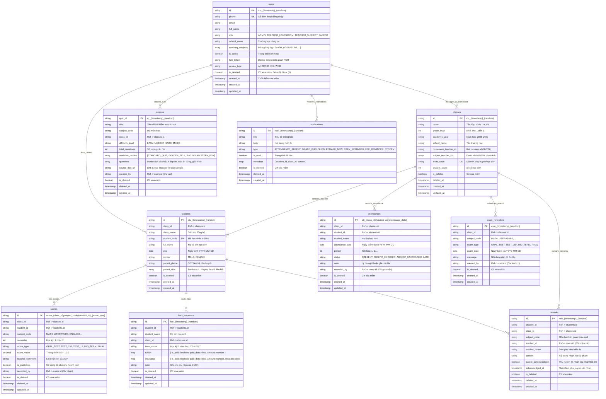

# Tài Liệu Ngăn Xếp Công Nghệ & Sơ Đồ CSDL (Tech Stack & Database Architecture)

# Hệ Thống GiaoVienHay – Quản Lý Học Sinh Cấp 1 & Cấp 2

---

## 1. Ngăn Xếp Công Nghệ Chuẩn (Technology Stack)

Hệ thống **GiaoVienHay** được xây dựng theo kiến trúc **Monorepo (Turborepo + pnpm v9)**, chuẩn hóa toàn bộ hạ tầng dữ liệu và dịch vụ đám mây trên nền tảng **Google Firebase & Render Cloud**:

| Tầng kiến trúc | Công nghệ chính | Mục đích & Chi tiết ứng dụng trong Mã Nguồn |
| :--- | :--- | :--- |
| **Monorepo Engine** | **Turborepo 2.x + pnpm 9.x** | Quản lý đồng bộ đa dự án (`apps/api`, `apps/mobile`, `apps/admin-web`, `packages/shared-types`). Tối ưu pipeline build, cache artifact và chia sẻ mã nguồn dùng chung. |
| **Shared Types Package** | **TypeScript (`@giaovienhay/shared-types`)** | Thư viện kiểu dùng chung: Toàn bộ Enums nghiệp vụ, mã lỗi chuẩn tiếng Việt (`ErrorCode`), Envelopes phản hồi API (`ApiResponse`), cấu trúc thực thể cơ sở (`BaseEntity`, `SoftDeletable`). |
| **Backend API** | **NestJS 10+ (Node.js 20)** | Backend dạng Module (12 phân hệ nghiệp vụ `01-auth` đến `12-admin` + phân hệ `health`). Tích hợp **Firebase Admin SDK** (`firebase-admin`) để xử lý nghiệp vụ và phân quyền RBAC. |
| **Database (Duy nhất)** | **Google Cloud Firestore (NoSQL)** | Cơ sở dữ liệu NoSQL Document Store thời gian thực, lưu trữ toàn bộ 10 collections: hồ sơ người dùng, lớp học, học sinh, điểm danh, sổ điểm, mini-game quiz, lời nhận xét, nhắc thi, bảo hiểm & học phí, nhật ký thông báo. |
| **In-Memory Cache (RAM)** | **`@nestjs/cache-manager` & `cache-manager`** | Bộ nhớ đệm RAM tốc độ cao (0ms) cho các truy vấn tần suất lớn: hồ sơ giáo viên/học sinh, danh sách lớp học, danh sách học sinh có mặt hôm nay nạp cho Vòng quay may mắn. |
| **Async Message Queue** | **`@nestjs/event-emitter` (EventEmitter2)** | Xử lý tác vụ ngầm bất đồng bộ (Background Event Workers). Ví dụ: gửi thông báo đẩy FCM và lưu log cảnh báo vắng học mà không làm nghẽn (block) luồng HTTP phản hồi của giáo viên. |
| **Performance Monitoring** | **TimingInterceptor** | Tự động đo thời gian phản hồi từng request (`X-Response-Time`), cảnh báo vàng `[SLOW_API]` trong server logs nếu thời gian xử lý vượt quá 500ms. |
| **API Documentation** | **Swagger UI (OpenAPI 3.0)** | Trang tài liệu tương tác và kiểm thử API trực tiếp tại `/api/docs`. |
| **Web Frontend (Admin)** | **Next.js 14+ (App Router)** | **Cổng Quản trị dành RIÊNG CHO PLATFORM ADMIN** tại `apps/admin-web`. Phụ trách: Quản lý người dùng, Khóa/Mở khóa tài khoản (Ban/Unban), Quản lý hạn ngạch API & AI. |
| **Mobile & Tablet Frontend** | **React Native (Expo 52+ / TypeScript)** | **Ứng dụng di động & máy tính bảng dành cho Giáo viên và Phụ huynh** tại `apps/mobile`. Điểm danh 1-chạm, vào sổ điểm, Vòng quay may mắn, 3 Mini-game chiếu bảng lớp, Sổ liên lạc phụ huynh. |
| **Authentication** | **Firebase Auth + JWT Access/Refresh Token** | Xác thực số điện thoại / OTP, email mật khẩu, sinh cặp JWT Token (Access Token 7 ngày, Refresh Token 30 ngày) kèm Security Guards (`JwtAuthGuard`, `RolesGuard`). |
| **File Storage** | **Firebase Cloud Storage** | Lưu trữ tài liệu giáo án bài giảng (`.docx`, `.pdf`) và ảnh chân dung người dùng/học sinh. |
| **AI Integration** | **Google Gemini AI API** (`@google/genai`) | Bóc tách tài liệu giáo án và tự động sinh câu hỏi trắc nghiệm/mini-game kèm đáp án và giải thích chi tiết cho Giáo viên trình chiếu tại lớp. |
| **Push Notification** | **Firebase Cloud Messaging (FCM)** | Đẩy thông báo tức thì (Cảnh báo vắng học, Công bố điểm số, Lời nhận xét mới, Nhắc lịch kiểm tra, Nhắc đóng BHYT/học phí) tới điện thoại phụ huynh. |
| **CI/CD Pipeline** | **GitHub Actions** | Tự động kiểm định Typecheck & Monorepo Build khi có PR hoặc push vào nhánh `main`, tự động kích hoạt deploy webhook tới Render Cloud. |
| **Hosting & Giữ Server 24/24** | **Render Cloud + UptimeRobot** | Triển khai Backend API container trên Render (`https://giaovienhay.onrender.com`), tích hợp endpoint `/api/v1/health` để UptimeRobot ping mỗi 5 phút giữ server luôn thức (chi phí 0 VNĐ). |

---

## 2. Thiết Kế Cấu Trúc Cơ Sở Dữ Liệu Cloud Firestore (10 Collections)

Toàn bộ 10 collection trong hệ thống đều tuân thủ nguyên tắc **Xóa Mềm (Soft Delete)**: mọi bản ghi đều có trường `is_deleted: boolean` (0 = Hoạt động, 1 = Đã xóa) và `deleted_at: timestamp | null` để bảo toàn dữ liệu lịch sử và tối ưu hiệu năng I/O.



---

## 3. Kiến Trúc Tích Hợp AI & Luồng Xử Lý Ngầm (Event-Driven Pipeline)

```text
[Giáo viên tải file .docx / .pdf hoặc text bài học từ App Mobile/Tablet]
                         │
                         ▼ (Lưu trữ an toàn)
            [Firebase Cloud Storage]
                         │
                         ▼
             [NestJS Backend API Gateway]
                         │
                         ▼ (Gửi trích xuất văn bản + Prompt sư phạm kiểm tra bài cũ)
          [Google Gemini API: gemini-1.5-flash]
                         │
                         ▼ (Trả về JSON bộ câu hỏi trắc nghiệm chuẩn)
      [Lưu vào Firestore /quizzes (kèm cờ is_deleted: false)]
                         │
                         ▼
[App React Native (Giáo viên kết nối Smartboard / Máy chiếu lớp học)]
                         │
        ┌────────────────┴────────────────┐
        ▼                                 ▼
 [Vòng quay ngẫu nhiên]         [3 Mini-Game tương tác]
(Lấy danh sách HS CÓ MẶT       (Rung Chuông Vàng, Đua Xe,
 từ In-Memory RAM Cache)           Hộp Quà Bí Mật)
        │                                 │
        └────────────────┬────────────────┘
                         ▼
        [Giáo viên chấm điểm & nhập điểm tức thời]
                         │
                         ▼ (Lưu vào /scores)
        [Hiển thị Bảng xếp hạng Top học sinh môn học]
                         │
                         ▼ (GV bấm "Công bố điểm")
      [EventEmitter2: Phát sự kiện 'scores.published']
                         │
                         ▼ (Worker xử lý ngầm không block HTTP)
          [Firebase Cloud Messaging (FCM)]
                         │
                         ▼
  [Đẩy thông báo tức thì đến App điện thoại của Phụ huynh]
```

---

## 4. Danh Sách Endpoint & Tên Miền Hệ Thống

Toàn bộ chi tiết liên kết production, endpoint Swagger UI, URL giám sát server và hướng dẫn tích hợp được quy định tập trung tại:
👉 **[`DOMAINS.md`](file:///e:/GiaoVienHay/DOMAINS.md)** ở thư mục gốc của dự án.
