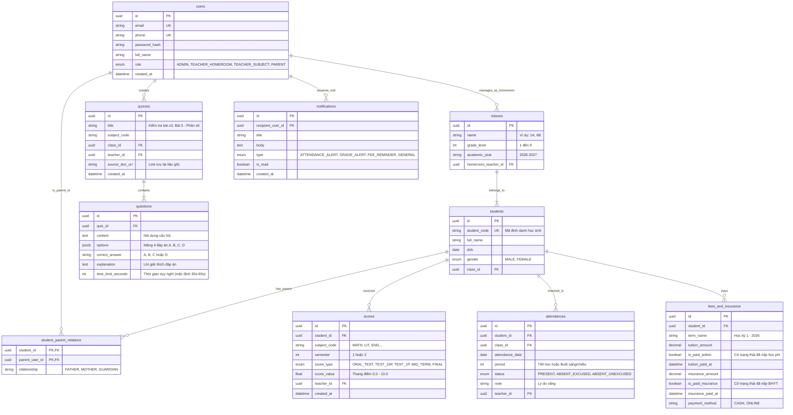

# Tài Liệu Ngăn Xếp Công Nghệ & Sơ Đồ CSDL (Tech Stack & Database Schema)
# Hệ Thống GiaoVienHay – Quản Lý Học Sinh Cấp 1 & Cấp 2

---

## 1. Ngăn Xếp Công Nghệ Chuẩn (Technology Stack)

| Tầng kiến trúc | Công nghệ chính | Mục đích & Chi tiết ứng dụng |
| :--- | :--- | :--- |
| **Web Frontend** | **Next.js 14+ (App Router)** | Web Quản trị cho Admin, GVCN & GVBM. Tích hợp màn hình Vòng quay Random học sinh và Chế độ trình chiếu bài kiểm tra cũ lên bảng lớp. |
| **Mobile Frontend** | **React Native (TypeScript)** | Mobile App cho Giáo viên (điểm danh nhanh) & Phụ huynh (xem điểm, xem chuyên cần, tra cứu tình trạng đóng Học phí & BHYT). |
| **Backend API** | **NestJS 10+ (TypeScript)** | Modular backend, xử lý RBAC Guards phân cấp (Admin, GVCN, GVBM, Parent), tích hợp Background Workers. |
| **AI Integration** | **Google Gemini API** (`@google/genai`) | Bóc tách tài liệu giáo án (.docx, .pdf) và tự động sinh câu hỏi kiểm tra bài cũ 5-10 phút đầu giờ. |
| **Relational Database** | **PostgreSQL (v15+)** | Lưu trữ toàn bộ 10 bảng dữ liệu cốt lõi, quan hệ chặt chẽ, đảm bảo tính toàn vẹn giao dịch (ACID). |
| **ORM / Data Access** | **Prisma ORM / TypeORM** | Quản lý schema, migrations an toàn, type-safe query. |
| **Document & Logs** | **MongoDB (v6+)** | Lưu trữ bài viết bảng tin nhà trường và audit logs lịch sử thay đổi điểm/điểm danh. |
| **Caching & Queues** | **Redis (v7+) & BullMQ** | Caching session, lưu Device Token FCM, quản lý hàng đợi gửi thông báo bất đồng bộ. |
| **Message Broker** | **RabbitMQ** | Định tuyến các sự kiện: `StudentAbsentEvent`, `GradePublishedEvent`, `FeeReminderEvent`. |
| **Push Notification** | **Firebase Cloud Messaging (FCM)** | Đẩy thông báo tức thì tới thiết bị di động của Phụ huynh. |

---

## 2. Thiết Kế Sơ Đồ Cơ Sở Dữ Liệu PostgreSQL (10 Bảng Cốt Lõi)

Hệ thống quản lý dữ liệu học sinh Cấp 1 & 2 xoay quanh 10 bảng thực thể cốt lõi:



---

## 3. Kiến Trúc Tích Hợp AI (Google Gemini API)

```text
[Giáo viên tải file .docx / .pdf lên Web Next.js]
                        │
                        ▼ (Multipart/Form-Data)
[NestJS: Academic/Quiz Controller]
                        │
                        ▼ (Lưu file gốc vào S3/MinIO & Trích xuất văn bản)
[Doc Parser Service: mammoth / pdf-parse]
                        │
                        ▼ (Gửi text trích xuất + Prompt sư phạm kiểm tra bài cũ)
[Google Gemini API: gemini-1.5-flash]
                        │
                        ▼ (Trả về JSON Schema câu hỏi)
[NestJS: Lưu bảng quizzes & questions] ──► [Web Next.js: Trình chiếu lên bảng lớp]
```

