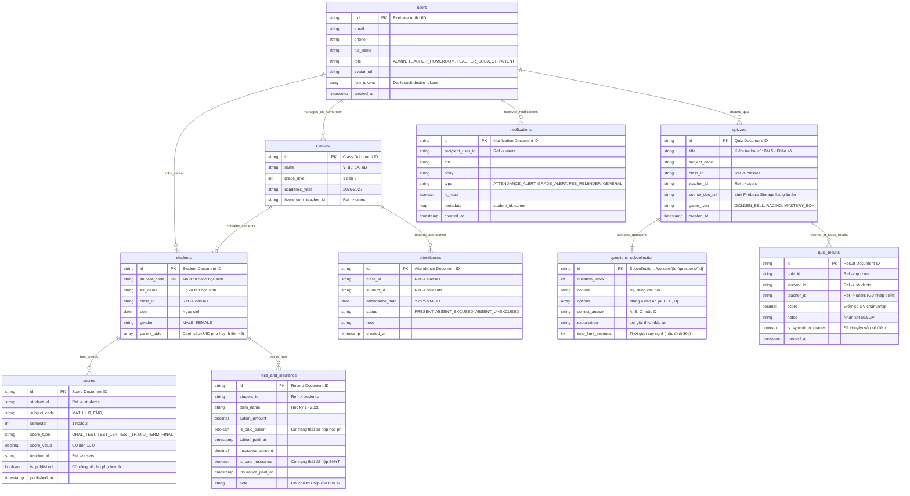

# Tài Liệu Ngăn Xếp Công Nghệ & Sơ Đồ CSDL (Tech Stack & Database Architecture)
# Hệ Thống GiaoVienHay – Quản Lý Học Sinh Cấp 1 & Cấp 2

---

## 1. Ngăn Xếp Công Nghệ Chuẩn (Technology Stack)

Hệ thống **GiaoVienHay** chuẩn hóa toàn bộ hạ tầng dữ liệu và dịch vụ đám mây trên nền tảng **Google Firebase**:

| Tầng kiến trúc | Công nghệ chính | Mục đích & Chi tiết ứng dụng |
| :--- | :--- | :--- |
| **Web Frontend** | **Next.js 14+ (App Router)** | **Web Quản trị dành CHỈ RIÊNG CHO PLATFORM ADMIN.** Phụ trách 3 nhóm quyền hạn quản trị: CRUD tài nguyên hệ thống/người dùng, Khóa/Mở khóa tài khoản (Ban/Unban), Quản trị Hạn ngạch (Limit/Quota tài nguyên và lượt gọi AI). Tuyệt đối không chứa route nghiệp vụ sư phạm hay cổng phụ huynh. |
| **Mobile & Tablet Frontend** | **React Native (TypeScript)** | **Ứng dụng di động & máy tính bảng dành cho Giáo viên (GVCN & GVBM) và Phụ huynh.** Giáo viên sử dụng Phone/Tablet để điểm danh, vào sổ điểm, chạy Vòng quay random, tổ chức 3 Mini-game (hỗ trợ chiếu Smartboard/Máy chiếu), gửi nhận xét, dặn dò lịch kiểm tra. Phụ huynh tra cứu học tập, điểm danh, nộp BHYT. |
| **Backend API** | **NestJS 10+ (TypeScript)** | Modular backend, tích hợp **Firebase Admin SDK** (`firebase-admin`) để xử lý nghiệp vụ, phân quyền RBAC và kiểm soát dữ liệu. |
| **Database (Duy nhất)** | **Google Cloud Firestore** | **Cơ sở dữ liệu NoSQL Document Store thời gian thực**, lưu trữ toàn bộ hồ sơ, lớp học, điểm danh, sổ điểm, cờ BHYT/học phí. |
| **Authentication** | **Firebase Authentication** | Quản lý đăng nhập an toàn đa phương thức: Số điện thoại (SMS OTP), Email & Mật khẩu. |
| **File Storage** | **Firebase Cloud Storage** | Lưu trữ tài liệu giáo án bài giảng (`.docx`, `.pdf`) và ảnh đại diện người dùng. |
| **AI Integration** | **Google Gemini API** (`@google/genai`) | Bóc tách tài liệu giáo án (.docx, .pdf) và tự động sinh câu hỏi/mini-game tương tác đầu giờ cho Giáo viên trình chiếu tại lớp. |
| **Push Notification** | **Firebase Cloud Messaging (FCM)** | Đẩy thông báo tức thì (Cảnh báo vắng học, Điểm số mới, Lời nhắc bài kiểm tra, Nhắc đóng BHYT) tới thiết bị di động của Phụ huynh. |
| **Realtime Sync** | **Firestore Snapshot Listeners** | Lắng nghe thay đổi dữ liệu thời gian thực (điểm danh lớp học, cập nhật điểm, bảng xếp hạng). |

---

## 2. Thiết Kế Cấu Trúc Cơ Sở Dữ Liệu Cloud Firestore (Collections & Documents)

Hệ thống quản lý dữ liệu học sinh Cấp 1 & 2 tổ chức theo mô hình NoSQL Collections & Documents trên **Cloud Firestore**:



---

## 3. Kiến Trúc Tích Hợp AI & Firebase

```text
[Giáo viên tải file .docx / .pdf từ App React Native (Phone/Tablet)]
                        │
                        ▼ (Lưu file giáo án gốc an toàn)
           [Firebase Cloud Storage]
                        │
                        ▼
           [NestJS Backend Controller]
                        ▼ (Gửi text trích xuất + Prompt sư phạm kiểm tra bài cũ)
        [Google Gemini API: gemini-1.5-flash]
                        │
                        ▼ (Trả về JSON bộ câu hỏi trắc nghiệm)
    [NestJS: Lưu vào Firestore /quizzes & subcollection /questions]
                        │
                        ▼
      [App React Native (Phone/Tablet kết nối Smartboard/Máy chiếu): Trình chiếu Mini-game lên bảng lớp]
                        │
                         ▼ (Giáo viên kiểm tra học sinh & trực tiếp nhập điểm tại lớp)
[Firestore /scores] ───────────────► [Hiển thị Bảng xếp hạng (Leaderboard) Điểm Môn Học cho GV xem]
                         │
                         ▼ (GV công bố điểm ──► Firestore Trigger / NestJS)
           [Firebase Cloud Messaging (FCM)]
                        │
                        ▼
   [Đẩy thông báo điểm tức thì đến App React Native của Phụ huynh]
```
