# ĐẶC TẢ THIẾT KẾ UI/UX & DANH MỤC TẤT CẢ MÀN HÌNH (STITCH AI DESIGN SPECS)
# DỰ ÁN GIAOVIENHAY - SMART SCHOOL & GAMIFICATION PLATFORM

Tài liệu này đặc tả toàn bộ hệ thống nhận diện UI/UX, Design System, danh mục và hình ảnh chụp thực tế của tất cả 14 màn hình thuộc hệ sinh thái **GiaoVienHay**, được tạo bởi **Stitch AI** và phân loại lưu trữ cục bộ trong thư mục `docs/fe/`.

---

## 1. THÔNG TIN DỰ ÁN TRÊN STITCH AI (STITCH PROJECT PROFILE)

- **Tên dự án:** `GiaoVienHay - Smart School & Gamification Platform`
- **Mã dự án (Project ID):** `419766646660451217`
- **Design System chuẩn:** `Sư Phạm Hiện Đại` (Asset ID: `assets/4a79e727aca7400186e7a5e9cd42ea14`)
- **Bộ phông chữ chuẩn (Universal Typography):** **`Be Vietnam Pro`** (Hỗ trợ 100% tiếng Việt có dấu, chuẩn mực sư phạm, không lỗi layout).
- **Quy chuẩn màu sắc (Design Tokens):**
  - **Màu chủ đạo (Primary Blue - `#2563EB` / `#004AC6`):** Điều hướng chính, sổ điểm, cấu trúc nền tảng, tạo cảm giác uy tín và học thuật.
  - **Màu chuyên cần (Emerald Green - `#10B981` / `#006C49`):** Đã điểm danh, có mặt, hoàn tất thu nộp học phí/BHYT, trạng thái an tâm.
  - **Màu tương tác / May mắn (Amber Orange - `#F59E0B`):** Vòng quay random, học sinh lên bảng, công cụ thu hút sự chú ý.
  - **Màu trợ giảng AI (Intelligence Violet - `#8B5CF6` / `#632ECD`):** Bóc tách giáo án, sinh đề thi trắc nghiệm Gemini AI.
  - **Màu trò chơi / Cảnh báo (Activity Rose - `#F43F5E` / `#BA1A1A`):** 4 Mini-games, đếm ngược giờ, vắng không phép.
  - **Màu nền (Canvas Background - `#F8FAFC` / `#FAF8FF`):** Slate sáng dịu mắt, chống chói khi trình chiếu máy chiếu lớp học.
  - **Thẻ nội dung (Surface Card - `#FFFFFF`):** Bo góc `16px` (`rounded-2xl`), viền mảnh `1px solid #E2E8F0`, đổ bóng mềm (soft elevation).

---

## 2. BẢNG DANH MỤC TỔNG HỢP TOÀN BỘ 14 MÀN HÌNH HỆ THỐNG

Tất cả 14 màn hình đã được khởi tạo hoàn chỉnh trên Stitch AI, tải ảnh chụp độ phân giải cao và lưu trữ vào đúng thư mục phân hệ tương ứng:

| STT | Mã màn hình | Tên màn hình | Phân hệ | Thiết bị | Tệp ảnh cục bộ | Stitch Screen ID |
|:---:|---|---|---|---|---|---|
| **01** | `WEB-01` | **Tổng quan Quản trị Nền tảng (Platform Dashboard)** | `docs/fe/web/` | Desktop (1440×900) | [admin-web-dashboard.png](file:///e:/GiaoVienHay/docs/fe/web/screenshots/admin-web-dashboard.png) | `cb69c2989f0443549028b4dd6183bcc4` |
| **02** | `WEB-02` | **Quản lý Người dùng & Phân quyền (User Management & Ban Modal)** | `docs/fe/web/` | Desktop (1440×900) | [admin-users-management.png](file:///e:/GiaoVienHay/docs/fe/web/screenshots/admin-users-management.png) | `81d9df101c6a4a998236dad709a32d58` |
| **03** | `WEB-03` | **Giám sát Lớp học & Hạn ngạch Quota AI (Classes & Limits)** | `docs/fe/web/` | Desktop (1440×900) | [admin-classes-limits.png](file:///e:/GiaoVienHay/docs/fe/web/screenshots/admin-classes-limits.png) | `ce1abaf520d64ad5a6cca1578982a51d` |
| **04** | `TEA-01` | **Trang chủ & Lịch dạy Giáo viên (Teacher Home Dashboard)** | `docs/fe/mobile/screenshots/teacher/` | Mobile (390×844) | [teacher-mobile-home.png](file:///e:/GiaoVienHay/docs/fe/mobile/screenshots/teacher/teacher-mobile-home.png) | `e952c6814513472f9a440f3175754882` |
| **05** | `TEA-02` | **Điểm danh Chuyên cần 1-Chạm (1-Tap Attendance Roll Call)** | `docs/fe/mobile/screenshots/teacher/` | Mobile (390×844) | [teacher-attendance.png](file:///e:/GiaoVienHay/docs/fe/mobile/screenshots/teacher/teacher-attendance.png) | `d5f2484f038c4784863390a1b6af4b05` |
| **06** | `TEA-03` | **Trợ giảng AI Gemini - Bóc tách Giáo án Sinh Đề (AI Quiz Generator)** | `docs/fe/mobile/screenshots/teacher/` | Mobile (390×844) | [teacher-ai-quiz.png](file:///e:/GiaoVienHay/docs/fe/mobile/screenshots/teacher/teacher-ai-quiz.png) | `03856d409db546e7ab5fd475c349c39c` |
| **07** | `TEA-04` | **Vòng quay May mắn Dò bài cũ (Lucky Wheel Mobile)** | `docs/fe/mobile/screenshots/teacher/` | Mobile (390×844) | [lucky-wheel-smartboard.png](file:///e:/GiaoVienHay/docs/fe/mobile/screenshots/teacher/lucky-wheel-smartboard.png) | `6f4c771d372c4783a7db80b835a72ded` |
| **08** | `TEA-05` | **Bộ 4 Mini-Game Tương tác Lớp học (Gamification Hub Mobile)** | `docs/fe/mobile/screenshots/teacher/` | Mobile (390×844) | [teacher-gamification-suite.png](file:///e:/GiaoVienHay/docs/fe/mobile/screenshots/teacher/teacher-gamification-suite.png) | `5e34d64693274c4b8259205531fc67cf` |
| **09** | `TEA-06` | **Sổ điểm Điện tử & Bảng vinh danh Học sinh (Gradebook Mobile)** | `docs/fe/mobile/screenshots/teacher/` | Mobile (390×844) | [teacher-gradebook.png](file:///e:/GiaoVienHay/docs/fe/mobile/screenshots/teacher/teacher-gradebook.png) | `18ad40654c334adeada57caa35f999d6` |
| **10** | `TEA-07` | **Quản lý Thu phí & Bảo hiểm y tế BHYT (Tuition & Insurance Tracker)** | `docs/fe/mobile/screenshots/teacher/` | Mobile (390×844) | [teacher-fees-insurance.png](file:///e:/GiaoVienHay/docs/fe/mobile/screenshots/teacher/teacher-fees-insurance.png) | `5c8a5d99b6ac4caf83dd1c0f75692d3d` |
| **11** | `PAR-01` | **Trang chủ Sổ liên lạc Điện tử Phụ huynh (Parent Home & Child Switcher)** | `docs/fe/mobile/screenshots/parent/` | Mobile (390×844) | [parent-mobile-home.png](file:///e:/GiaoVienHay/docs/fe/mobile/screenshots/parent/parent-mobile-home.png) | `598d162a03ac49e3aa6d858900e2394e` |
| **12** | `PAR-02` | **Kết quả Học tập & Lời nhận xét của Con (Student Academic Grades)** | `docs/fe/mobile/screenshots/parent/` | Mobile (390×844) | [parent-academic-grades.png](file:///e:/GiaoVienHay/docs/fe/mobile/screenshots/parent/parent-academic-grades.png) | `7121039f6b66438fa8195c5008852a32` |
| **13** | `PAR-03` | **Tra cứu & Thanh toán Học phí, BHYT VietQR (Parent Fees & VietQR)** | `docs/fe/mobile/screenshots/parent/` | Mobile (390×844) | [parent-fees-insurance.png](file:///e:/GiaoVienHay/docs/fe/mobile/screenshots/parent/parent-fees-insurance.png) | `8f1d17264635415b9b0fbda57a132a9f` |
| **14** | `PAR-04` | **Trung tâm Thông báo Đẩy FCM Thời gian thực (Realtime Notifications Feed)** | `docs/fe/mobile/screenshots/parent/` | Mobile (390×844) | [parent-notifications.png](file:///e:/GiaoVienHay/docs/fe/mobile/screenshots/parent/parent-notifications.png) | `0ebb28890106416eb5ff518039af847f` |
| **15** | `SMB-01` | **Vòng quay May mắn Chiếu TV / Bảng lớp (Smartboard Lucky Wheel)** | `docs/fe/smartboard/screenshots/` | Smartboard / TV (16:9) | [smartboard-lucky-wheel.png](file:///e:/GiaoVienHay/docs/fe/smartboard/screenshots/smartboard-lucky-wheel.png) | `574e7f44d6354c4cb633e10d1c0bfac8` |
| **16** | `SMB-02` | **Đấu trường Rung Chuông Vàng Chiếu TV (Smartboard Golden Bell)** | `docs/fe/smartboard/screenshots/` | Smartboard / TV (16:9) | [smartboard-golden-bell.png](file:///e:/GiaoVienHay/docs/fe/smartboard/screenshots/smartboard-golden-bell.png) | `29e858c0cd57405c83e68875d606f469` |
| **17** | `SMB-03` | **Đường đua Xe 4 Tổ Chiếu TV (Smartboard Class Racing)** | `docs/fe/smartboard/screenshots/` | Smartboard / TV (16:9) | [smartboard-class-racing.png](file:///e:/GiaoVienHay/docs/fe/smartboard/screenshots/smartboard-class-racing.png) | `656a54e13edb43bca8b327392398798c` |
| **18** | `SMB-04` | **Bục Vinh danh & Tổng kết Tiết học Chiếu TV (Smartboard Leaderboard)** | `docs/fe/smartboard/screenshots/` | Smartboard / TV (16:9) | [smartboard-leaderboard.png](file:///e:/GiaoVienHay/docs/fe/smartboard/screenshots/smartboard-leaderboard.png) | `7b129fdba7034679982039f78203be79` |

---

## 3. THƯ VIỆN ẢNH CHI TIẾT THEO PHÂN HỆ

### 3.1. Phân hệ Web Quản trị Nền tảng (Desktop 1440×900)
Thư mục lưu trữ: `docs/fe/web/screenshots/`

#### 1. Tổng quan Quản trị Nền tảng (`admin-web-dashboard.png`)
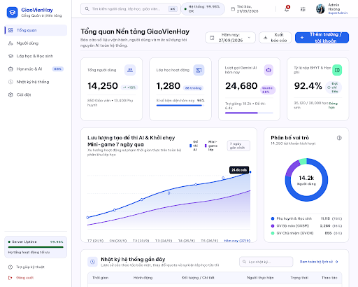

#### 2. Quản lý Người dùng & Hộp thoại Khóa tài khoản (`admin-users-management.png`)
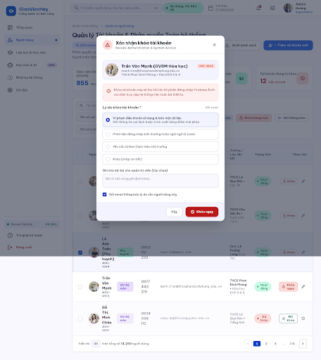

#### 3. Giám sát Lớp học & Hạn ngạch Quota AI (`admin-classes-limits.png`)
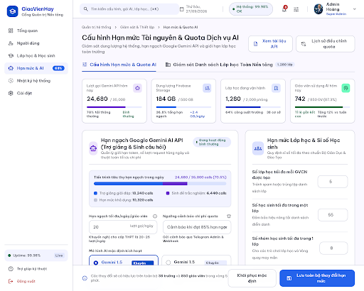

---

### 3.2. Phân hệ Mobile & Tablet Giáo Viên
Thư mục lưu trữ: `docs/fe/mobile/screenshots/teacher/`

#### 4. Trang chủ & Lịch dạy Giáo viên (`teacher-mobile-home.png` - Mobile 390×844)
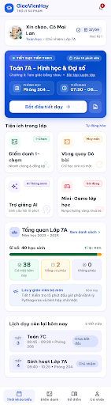

#### 5. Điểm danh Chuyên cần 1-Chạm (`teacher-attendance.png` - Mobile 390×844)
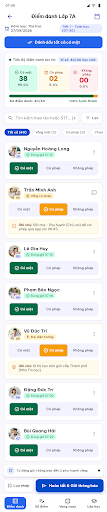

#### 6. Trợ giảng AI Gemini Bóc tách Giáo án (`teacher-ai-quiz.png` - Mobile 390×844)
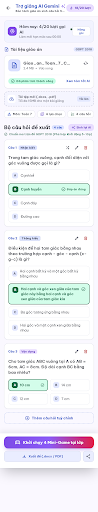

#### 7. Vòng quay May mắn Dò bài cũ (`lucky-wheel-smartboard.png` - Mobile 390×844)
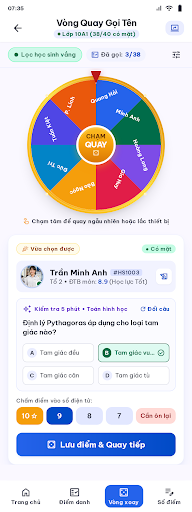

#### 8. Bộ 4 Mini-Game Tương tác Lớp học (`teacher-gamification-suite.png` - Mobile 390×844)
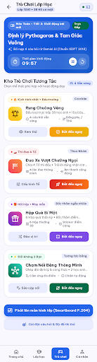

#### 9. Sổ điểm Điện tử & Bảng Vinh danh Tuần (`teacher-gradebook.png` - Mobile 390×844)
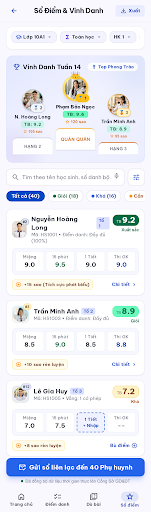

#### 10. Quản lý Thu nộp Học phí & BHYT Lớp Chủ nhiệm (`teacher-fees-insurance.png` - Mobile 390×844)
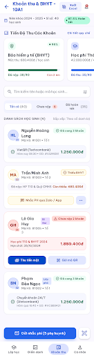

---

### 3.3. Phân hệ Mobile Phụ Huynh
Thư mục lưu trữ: `docs/fe/mobile/screenshots/parent/`

#### 11. Sổ liên lạc Điện tử Phụ huynh & Đổi con (`parent-mobile-home.png` - Mobile 390×844)
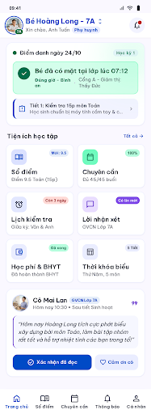

#### 12. Kết quả Học tập & Nhận xét của Con (`parent-academic-grades.png` - Mobile 390×844)
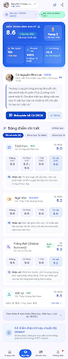

#### 13. Tra cứu & Thanh toán Học phí / BHYT VietQR (`parent-fees-insurance.png` - Mobile 390×844)
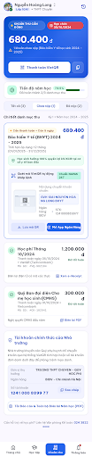

#### 14. Trung tâm Thông báo Đẩy FCM Thời gian thực (`parent-notifications.png` - Mobile 390×844)
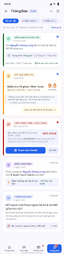

---

### 3.4. Phân hệ Trình chiếu Smartboard / TV Lớp Học (Tỉ lệ 16:9 Landscape Fullscreen)
Thư mục lưu trữ: `docs/fe/smartboard/screenshots/`

#### 15. Vòng quay May mắn Chiếu TV / Bảng lớp (`smartboard-lucky-wheel.png` - Smartboard 16:9)
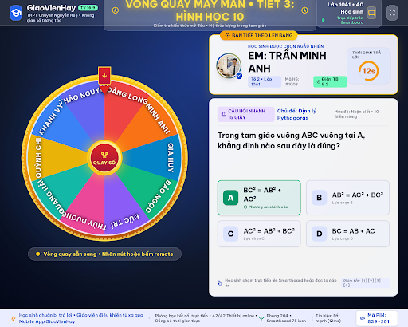

#### 16. Đấu trường Rung Chuông Vàng Chiếu TV (`smartboard-golden-bell.png` - Smartboard 16:9)
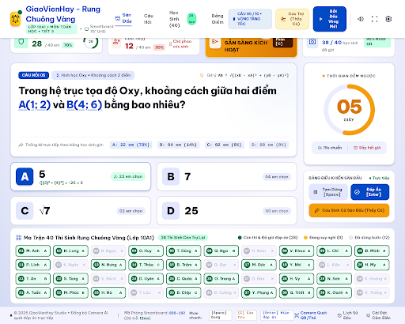

#### 17. Đường đua Xe 4 Tổ Vượt Chướng Ngại Vật (`smartboard-class-racing.png` - Smartboard 16:9)
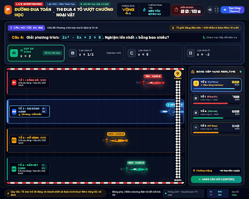

#### 18. Bục Vinh danh & Tổng kết Tiết học Chiếu TV (`smartboard-leaderboard.png` - Smartboard 16:9)
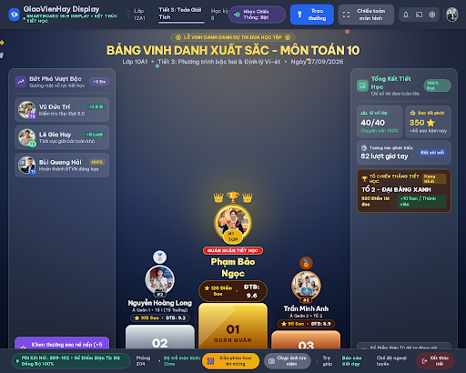

---

## 4. HƯỚNG DẪN KỸ THUẬT CHO ĐỘI NGŨ PHÁT TRIỂN (DEVELOPMENT SPECS)

### 4.1. Ứng dụng Quản trị Web Next.js ([apps/admin-web](file:///e:/GiaoVienHay/apps/admin-web))
- **Màu sắc & Tokens:** Tuân thủ hệ màu `primary: #2563EB`, nền `#FAF8FF` / `#F8FAFC`, thẻ trắng bo góc `16px`.
- **Layout & Routing:**
  - `/dashboard`: Bố cục `admin-web-dashboard.png` với 4 thẻ KPI thống kê, biểu đồ hoạt động và bảng Audit Log.
  - `/users`: Bố cục `admin-users-management.png` tích hợp bảng phân quyền, tìm kiếm bộ lọc và modal xác nhận khóa tài khoản tức thời.
  - `/classes`: Bố cục `admin-classes-limits.png` hỗ trợ quản lý lớp học và cấu hình thanh trượt hạn mức Quota Gemini AI (20 lượt/ngày).

### 4.2. Ứng dụng Di động React Native ([apps/mobile](file:///e:/GiaoVienHay/apps/mobile))
- **Typography:** Cài đặt font chữ **Be Vietnam Pro** (các weight 400, 600, 700) để đảm bảo dấu tiếng Việt hiển thị chính xác.
- **Giáo viên (Teacher Module - Mobile Portrait 390×844):**
  - Giao diện dạng dọc bỏ túi: Giáo viên cầm điện thoại đóng vai trò là **Tay cầm điều khiển (Remote Control)** khi chiếu lên TV.
  - Bàn phím số nổi (Floating Numeric Keypad) trong màn hình sổ điểm `teacher-gradebook.png` giúp giáo viên nhập điểm 1-chạm cực nhanh trên màn hình cảm ứng.
  - Tích hợp tính năng bóc tách file Word/PDF giáo án gửi tới backend Gemini AI (`teacher-ai-quiz.png`).
- **Phụ huynh (Parent Module - Mobile Portrait 390×844):**
  - Chuyển đổi hồ sơ học sinh (Child Switcher Dropdown) ở đầu trang nếu phụ huynh có từ 2 con trở lên (`parent-mobile-home.png`).
  - Tích hợp chuẩn VietQR động với ngân hàng NAPAS 247 cho phép phụ huynh quét mã chuyển khoản nộp BHYT và Học phí ngay trong app (`parent-fees-insurance.png`).
  - Lắng nghe sự kiện thông báo FCM Background / Foreground để cập nhật thời gian thực vào feed `parent-notifications.png`.

### 4.3. Phân hệ Màn hình TV / Smartboard Lớp Học ([apps/admin-web](file:///e:/GiaoVienHay/apps/admin-web) hoặc Sub-route `/tv`)
- **Tỉ lệ khung hình:** Khóa cố định 16:9 Landscape Fullscreen (1920×1080 hoặc 4K), font chữ lớn đọc rõ từ khoảng cách 10m ở cuối lớp học.
- **Giao thức kết nối Dual-Screen:**
  - Trên Smartboard/TV: Mở trình duyệt Web tại đường dẫn `/tv/[classId]` với mã PIN 6 số (VD: `889-102`).
  - Lắng nghe sự kiện WebSocket / Supabase Realtime từ điện thoại giáo viên để xoay vòng may mắn, đếm ngược thời gian Rung chuông vàng và kích hoạt Nitro đường đua xe 4 tổ.
  - Toàn bộ câu hỏi hiển thị công khai trên TV, nhưng đáp án bí mật chỉ hiển thị trên máy giáo viên cho đến khi học sinh trả lời xong.

